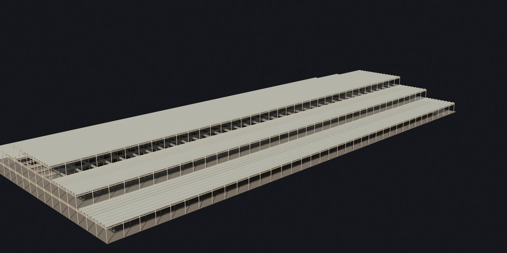

# The Crystal Palace

A research and 3D reconstruction project led by **Nik Bear Brown**, bringing together historical images, architectural drawings, editable Blender models, render comparisons and book material. The project covers **Hyde Park in 1851 and the rebuilt Palace at Sydenham from 1854 onward**, including exhibition objects, gardens and later surviving fragments.

The repository now contains a substantial reference collection, **67 individual model packages**, a drawing-based partial architectural reconstruction, and a separate textured conversion of a supplied building model. These are different kinds of work: a rendered asset is not automatically a verified historical reconstruction, and a collection of props is not yet a finished Palace scene or film.

*A completed render from the supplied-model conversion. Its geometry and scale are inherited from that asset, not verified against the historical drawings. See the [conversion notes and comparisons](blender-deliverables/README.md).*

## Progress at a glance

Snapshot checked **October 27, 2026**, against the committed files on `main`. Counts describe the repository, not unpushed local work.

| Workstream | Available so far | What the count means |
|---|---:|---|
| Reference catalogue | **8,860 records** | Discovered/catalogued files, including items not downloaded; not 8,860 useful Palace photographs. |
| Downloaded Muse reference collection | **1,398 files** | Every manifest record marked downloaded has a corresponding committed file. Includes photographs, engravings, book pages, drawings and incidental material. |
| Original Downes working plates | **28 plates** | Separate source-scan set and plate index; do not confuse this with the Muse collection's 22 large plate re-exports. |
| Research review aids | **1,398 thumbnails; 35 contact sheets** | Generated browsing aids, not additional source discoveries. The review also provides a 76-reference shortlist. |
| Individual 3D model packages | **67** | Each folder under `models/` contains both a native `.blend` and a `.glb` export. Includes studies, simplified interpretations and related variants. |
| Model render files | **274** | Image files under `models/*/renders/`; multiple views and variants, not 274 different models. |
| Drawing-based Hyde Park frame | **37 of 77 bays; 7,757 placed parts** | The documented west-half frame, not the complete building. |
| Supplied-model conversion | **One reduced textured Blender scene** | Conversion, material reconstruction and comparison renders are available separately from the historical reconstruction. |

**Why some older pages say 1,393 images:** the original-image folder contains 1,393 files with conventional raster-image extensions, two SVGs, and three files with truncated/nonstandard filename suffixes. Together these are the 1,398 downloaded records. The [manifest](references/muse-drive/data/manifest.csv) and [research review](references/muse-drive/review/REVIEW.md) explain the collection; generated previews must not be counted again as sources. The review also identifies one exact duplicate image pair, so downloaded files are not a count of unique historical views.

## What has been done

### Historical research and source review

The collection brings together Downes's working drawings, guidebooks, exhibition engravings, photographs, court plans, maps and later views. Its sources include Wikimedia/Commons, Internet Archive scans and reproductions of Paxton's concept drawings. The material supports both structural modeling and the contents and settings of the two Palaces.

The research pass produced a [searchable offline gallery](references/muse-drive/review/index.html), [source review and corrections](references/muse-drive/review/REVIEW.md), [76-reference shortlist](references/muse-drive/review/shortlist.csv), [Downes plate crosswalk](references/muse-drive/review/DOWNES-CROSSWALK.md), and [transcribed dimensions from the 1856 guide](references/muse-drive/review/dimensions-from-1856-guide.json). The recorded import audit includes file hashes; the review describes collection-wide screening and OCR of 40 selected pages/images, not a verified transcription of every page.

The manifest distinguishes the **1,398 downloads** from **7,380 budget-skipped records**, **56 media-type skips**, and **26 size skips**. Some collected material is comparative or irrelevant: the New York Crystal Palace is a different building, and the review identifies two SVG interface icons. The catalogue is a research starting point, not blanket historical validation.

### Architectural reconstruction from working drawings

The [Hyde Park course model](course-models/crystal-palace-1851-claude/README.md), built by Claude, reconstructs the west half's iron frame from Charles Downes's 1852 drawings. Its package reports **37 bays, 7,757 placed parts, 12 library collections and 1,081,608 triangles with instances**. The modeled extent is 888 × 408 ft between column lines.

*Current partial frame: columns, girders, gallery and stair work, with simplified roof surfaces. It is explicitly unfinished; the remainder of the building and its complete enclosure are not represented here.*

The package includes section, nave, gallery, staircase and joint renders, build scripts, recorded checks, and [comparisons with Plates VI and XV](course-models/crystal-palace-1851-claude/README.md#compare-with-references). Those comparisons test consistency with the drawings used to build the model; they are not independent proof of accuracy. Read the [departures ledger](course-models/crystal-palace-1851-claude/DEPARTURES-LEDGER.md) before treating the geometry as complete.

### Conversion of the supplied building model

The [Blender conversion package](blender-deliverables/README.md), prepared by Codex, preserves a separate supplied model while rebuilding materials and glazing and producing a smaller course copy. Its documented reduced scene has **11 mesh objects, 2,143,430 triangles and 16 materials**. Four camera views and source-versus-conversion comparisons make the changes inspectable.

This is conversion work, not original authorship of the supplied geometry. The source creator and licence were not identified in the supplied files. Its scale and historical identity still require source-based validation; do not substitute it for the Downes reconstruction merely because it looks more complete.

### Individual models and exhibition assets

The [67 model folders](models/) contain architectural components, exhibition objects, machinery, sculpture, garden elements and later-state studies. The [model gallery](models/README.md) supplies thumbnails and accuracy notes for many of them; each package's own notes should guide its use.

| Group | Examples already committed |
|---|---|
| Structural components | Cast-iron column and standards, lattice girder bay, Paxton gutter, glazing/sash panel, floor boards, gallery stair and roof-furrow bay |
| Exhibition objects and machinery | Osler crystal fountain, cut-glass chandelier, exhibition medal, Nasmyth steam-hammer exhibit, line shafting, locomotive, carriage and vacuum sugar apparatus |
| Sculpture and court details | Egyptian Court colossi, Assyrian lamassu, Andromeda, Aristides, Farnese Bull, The Three Graces, Una and the Lion, Alhambra panel and Gothic/Renaissance fragments |
| Gardens, circulation and later states | Fountain basins, urns, benches, terrace components, subway vault bay, post-1866 closure, ruin fragments and present-day outline markers |

Package counts include related alternatives and massing studies; they do not imply 67 independently authenticated objects or 67 assets approved for every scene. Historical period, inferred geometry, source limitations and review state remain package-specific.

## Selected model renders

These are existing renders from the committed model packages, not photographs of the original objects.

### Osler crystal fountain — Hyde Park 1851

The [Hyde Park fountain package](models/hp-osler-crystal-fountain/) models the cut-crystal exhibit with transmission materials and fluted geometry. Its notes distinguish documented dimensions from interpretation and keep the 1851 installation separate from the later Sydenham setting.

### Egyptian Court colossi — Sydenham

The [colossi package](models/egyptian-court-colossi/) uses a frontal historical photograph for proportions. It is stylized, with depths, sides and backs inferred; the visible detail is not presented as surveyed sculpture.

### Subway vault bay — Sydenham

The [subway package](models/sy-subway-vault-bay/) demonstrates a repeated vault bay with patterned brickwork. Its notes identify it with the 1865 High Level subway and describe photographic estimates rather than survey measurements; it does not belong in an 1854 opening-day scene.

## What is still in progress

- **Complete building reconstruction:** the documented Hyde Park asset remains a west-half frame. A historically checked, date-specific Sydenham shell must be established independently, not made by scaling the Hyde Park model.
- **Assembly and scene work:** individual props still need correct placement, lighting, terrain, circulation and period-specific context. A prop render is not a completed exhibition interior.
- **Evidence and review:** camera-matched source checks, dimensions, finishes and unseen geometry need further review where package notes flag uncertainty. A model's presence does not establish human approval.
- **Film production:** [model and film recommendations](references/muse-drive/review/MODEL-AND-FILM-PLAN.md) and [scene/prop planning](models/SCENE-BUILD-PLAN.md) exist. They are plans, not evidence of a finished film; the architectural packages still label their companion films as forthcoming.
- **Gallery maintenance:** at this snapshot, the `models/README.md` gallery covers 56 distinct packages, with one repeated Alhambra entry. Eleven other packages are present in the folder listing but not yet represented in that gallery. Some build-plan status text also predates the committed assets; consult the actual package and its notes rather than reading a queue as current completion status.

The central research rule is to keep **Hyde Park 1851, Sydenham's successive states, and present-day remains separate**. Printed dimensions, photographic estimates, schematic geometry and unknowns should remain distinguishable. See the [research review](references/muse-drive/review/REVIEW.md) and [model/film evidence gaps](references/muse-drive/review/MODEL-AND-FILM-PLAN.md).

## Find and use the material

| Location | Contents and starting point |
|---|---|
| [references/](references/README.md) | Consolidated research, provenance, working plates, measurements, reviews and source links |
| [references/muse-drive/](references/muse-drive/review/REVIEW.md) | Downloaded research collection and its reviewed corrections; use the review alongside the original collection README |
| [models/](models/) | All individual model folders; [gallery](models/README.md), [candidates](models/CANDIDATES.md) and [build plan](models/BUILD-PLAN.md) |
| [course-models/](course-models/crystal-palace-1851-claude/README.md) | Drawing-based partial frame, native scene, render views, scripts, comparisons and checks |
| [blender-deliverables/](blender-deliverables/README.md) | Supplied-model conversion, reduced native scene, render viewer and conversion evidence |
| [maps/](maps/) | Texture maps |
| [crystal/](crystal/) | [Book manuscript](crystal/crystal.md) and accompanying images |

For an individual prop, open its folder to download the `.blend` or `.glb`, inspect `renders/`, and read its notes before placing it in a scene. The architectural packages document their own Blender-version and export limits. Download an included HTML viewer with the supporting files where required; a GitHub HTML source view is not the running viewer. The conversion viewer is a render gallery, not a live 3D orbit viewer.

Large originals are not all committed: the previous inventory records a full-resolution `.blend` of about 234 MB, `maps.zip`, audiobook audio and scan archives retained locally. Follow the files actually present and the package-specific download notes rather than assuming a complete local working archive is mirrored here.

## Credits, provenance and reuse

Project direction: **Nik Bear Brown**. The individual model library is credited to Muse in its [model index](models/README.md) and [build brief](MUSE-PROMPT.md); the drawing-based course model credits Claude; the supplied-model conversion credits Codex. Consult each package for its specific sources and contributions.

Image licences vary. Check the `license`, `license_url` and source fields in the [reference manifest](references/muse-drive/data/manifest.csv), along with the relevant model notes, before reuse or redistribution. Historical subject matter does not make every reproduction or derivative unrestricted. Some source material carries Creative Commons share-alike requirements, some scans have rights caveats, and the supplied model's original licence remains unidentified.
