# Models

Built by Muse from the reference images. See `../MUSE-PROMPT.md`.

| Model | Thumbnail | Triangles | Accuracy note |
|---|---|---|---|
| [Egyptian Court colossi](egyptian-court-colossi/) |  | 30,232 | Abu Simbel-type seated pair as at Sydenham, c.1856 (film scene CP038). All proportions measured from the single frontal photograph in the collection; height (20.0 m statues) **inferred** from that photograph's pedestal-door ratio and corroborated by the 1856 guide's statement that the figures equal the Abu Simbel originals in size. Depths, sides and backs are inferred — no side view survives in the collection. Stylised block construction, no invented inscriptions. See `egyptian-court-colossi/NOTES.md`. |
| [Hyde Park tier-1 iron column + girder stub](hyde-park-column-tier1/) |  | 2,560 | Hyde Park 1851 only. Floor to girder bottom 19 ft 2 in and 3 ft girder depth are printed on Downes Plate VIII; outer diameter 10 in is nominal (printed bore 8 in, wall range ⅜–1¼ in); intermediate collar positions, girder stub length (1.5 m) and paint colour are inferred/interpretive. Full table in `hyde-park-column-tier1/NOTES.md`. |
| [Hyde Park glazing and sash panel](hp-glazing-and-sash-panel/) |  | 156 | Hyde Park 1851 only. Sash-bar centres 10½ in (Plate XII) and glass length 49 in (printed p.15); bar section, end-rail width and glass thickness are guessed. Full table in `hp-glazing-and-sash-panel/NOTES.md`. |
| [Hyde Park open-boarded floor section](hp-floor-boards/) |  | 288 | Hyde Park 1851 only. Boards 1½ in thick, ½ in gaps, joists 7 × 2½ in, sleepers 13 × 3¼ in at 8 ft — all printed in the Official Catalogue (1851) Introduction p.62, Paxton's own account; board width (9 in) and joist spacing (2 ft) inferred and labelled. 24 objects: 15 boards, 7 joists, 2 sleepers. Full table in `hp-floor-boards/NOTES.md`. |
| [Great elm, procedural generic](hp-great-elm/) |  | 628 | Hyde Park 1851 only. Generic mature-elm silhouette for instancing in transept scenes — all sizes guessed (18 m height, 5 m clear trunk); no dimensioned elm exists in the references, so never caption it as a particular transept elm or quote its height as measured. Full table in `hp-great-elm/NOTES.md`. |
| [Packing crate + exhibition vitrine](hp-crate-and-display-case/) |  | 360 | Hyde Park 1851 only. Slatted crate (1.0 × 0.8 × 0.8 m) beside a glass vitrine on a plinth (glass 1.2 × 0.6 × 1.0 m, plinth 0.9 m) — all sizes guessed; vitrine form follows the Dickinson plates, no contents or labels invented. Full table in `hp-crate-and-display-case/NOTES.md`. |
| [Sydenham terrace step + balustrade](sy-terrace-step-and-balustrade/) | 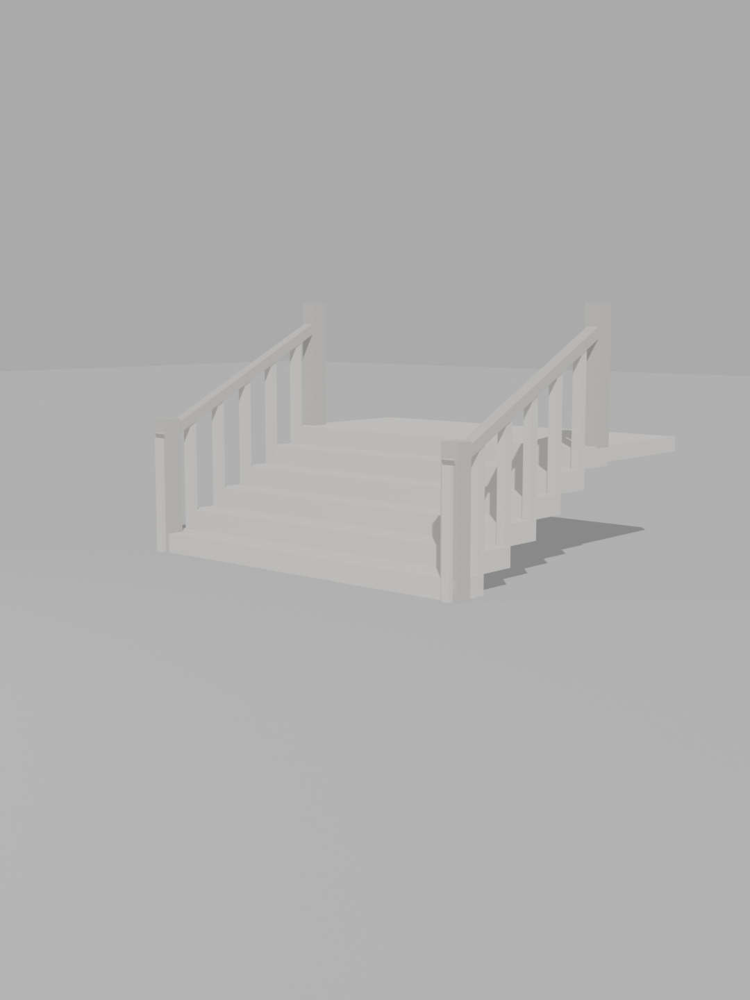 | 324 | Sydenham only, no specific terrace level or date asserted. 6 steps, 0.30 m going / 0.15 m rise, 3.0 m wide, balustrade both sides — all sizes guessed; the 1857 map gives position, not step sizes. No fountains implied. Full table in `sy-terrace-step-and-balustrade/NOTES.md`. |
| [1936 ruin fragment](sy36-ruin-fragment/) | 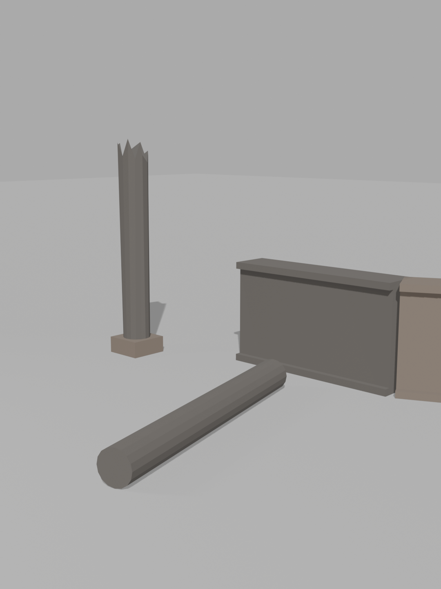 | 204 | Sydenham post-1936-fire state only — never an intact component. Broken column stub, kinked fallen girder, fallen column length. Column diameter and girder depth reused from the column prop; break height, kink, flange width and lengths guessed; generic ruin, not a surveyed remain. Full table in `sy36-ruin-fragment/NOTES.md`. |
| [Present-day plateau marker](park-now-plateau-marker/) |  | 120 | Present-day Sydenham park only — an overlay aid, not a building. Flat outline + 6 marker posts, 1,608 × 384 ft from the 1856 guide table. Registration explicitly approximate until a georeferenced plan + modern survey align it; never a Hyde Park grid. Full table in `park-now-plateau-marker/NOTES.md`. |
| [Sydenham water-tower massing study](sy-tower-study/) |  | 48 | Massing study only — a scale reference for the shell builder, not a reconstruction. Two plain 20 m square × 70 m masses, 80 m apart, flat caps; every size guessed, no tower form, height or demolition narrative asserted. Full table in `sy-tower-study/NOTES.md`. |
| [Chatsworth glasshouse rib bay](chatsworth-glasshouse-rib-bay/) | 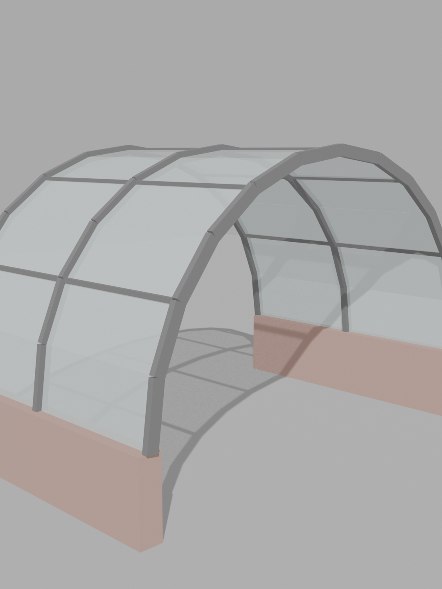 | 804 | Illustrative glasshouse bay only — not a surveyed Chatsworth room, not Palace geometry. Three curved ribs, 5 purlins, glass panes, two low side walls; all sizes guessed, Palace rib figures deliberately not reused. Full table in `chatsworth-glasshouse-rib-bay/NOTES.md`. |
| [Alhambra Court arch panel](sy-alhambra-ornament-panel/) | 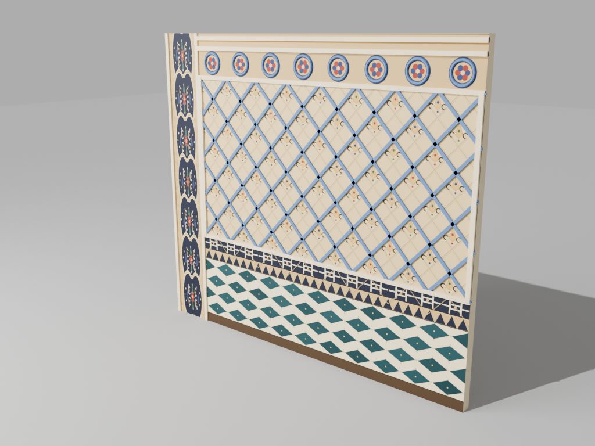 | 696 | Simplified arch panel from a single in-repo Owen Jones entrance view — not surveyed decoration. Pointed arch, slender columns, stepped muqarnas stylisation, diamond frieze; arch profile, muqarnas and colours are approximations. Full table in `sy-alhambra-ornament-panel/NOTES.md`. |
| Sydenham subway vault bay (`sy-subway-vault-bay/`) | 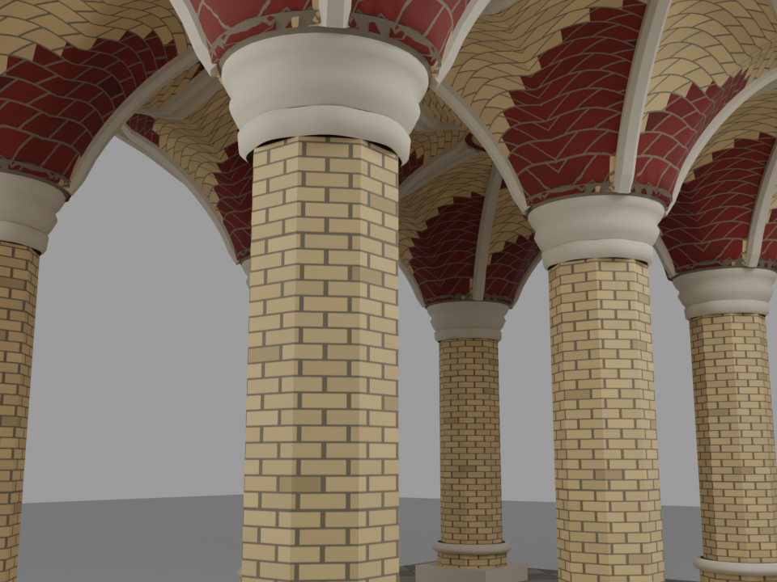 | 20,112 | Sydenham, 1865 High Level subway ONLY (CP046/CP065/CP071 states). One tileable bay: octagonal cream-brick column, stone capital, fan vault in red-and-cream brick with the listed diamond pattern. The subway survives: dimensions were derived three converging ways from the restoration photographs (round 2, S87) and are photo-estimates (±10%), not a survey. Full notes in `sy-subway-vault-bay/NOTES.md`. |
| [Cast-iron standards A–D](cast-iron-standards/) | 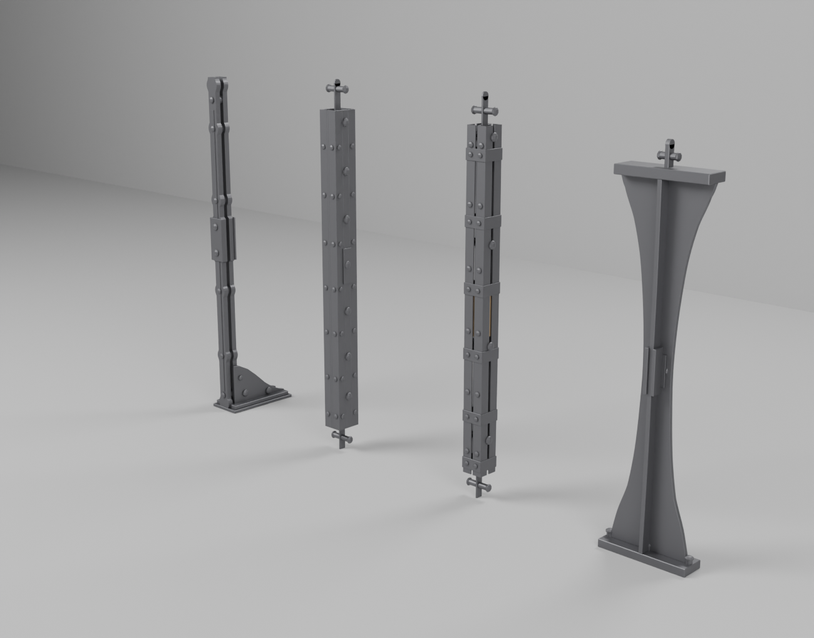 | 25,756 | Hyde Park 1851 only. The four standards of Downes Plate 20a in a row: A, a pinned pair of waisted straps with the curved foot bracket M; B, a riveted box of four printed 2¼ in angle irons; C, the open angle frame with batten bands and timber block K; D, the one-piece cruciform casting with printed 6 in waist. All sizing from the plate's own printed dimensions (common scale ≈ 22.5 px/in, ±4%); C's unseen front width is assumed from B, and A's strap rib and bracket joint are interpreted — see `cast-iron-standards/NOTES.md`. |
| Sydenham classical cast base, two variants (`sy-classical-cast-base/`) | 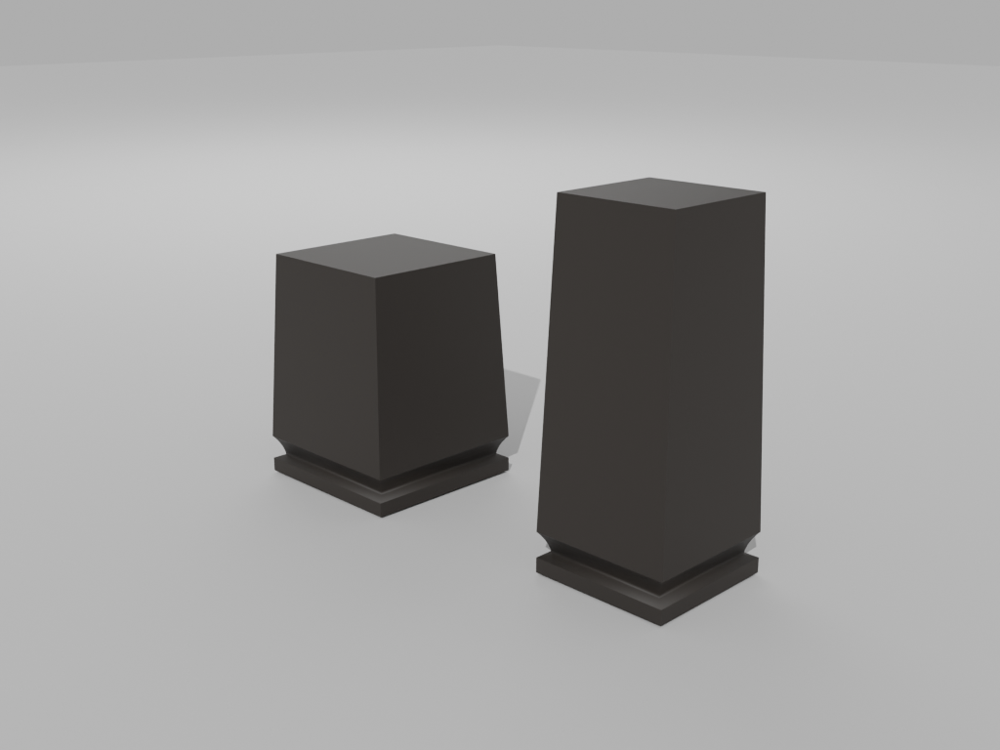 | 136 | Sydenham 1854 only. The courts' standard dark pedestal: figure height 0.91 m and bust height 1.30 m, plain square die on a foot-step + cove moulding, flat bedding top for a separately-sourced cast. Ratios measured from an eye-level stereo photograph against life-size casts; absolute scale ±0.06–0.08 m. Painted catalogue labels existed but are omitted (no fabricated text). Full notes in `sy-classical-cast-base/NOTES.md`. |
| [Sydenham garden fountain basin](garden-fountain-basin/) | 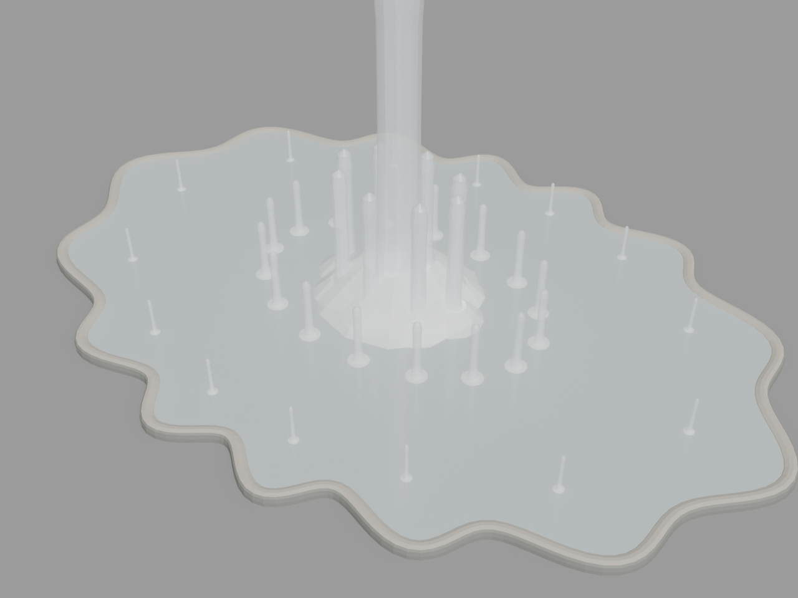 | 12,632 | Sydenham lower gardens only — the great lower basin in its playing state (storyboard CP042). Lobed plan-form read from the 1886 elevated photograph and the Delamotte view; every absolute dimension **inferred** from the photographs (±~20%) — no measured basin dimension exists in the references. Rim profile simplified (distant in both photos); jets are static display forms; rim urns and statuary are separate candidates, not included. Full table in `garden-fountain-basin/NOTES.md`. |
| Sydenham great fountain basin (`sy-fountain-basin/`) | 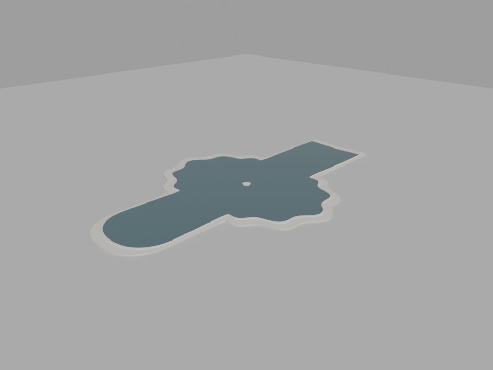 | 19,768 | Sydenham, c.1856–57 onward ONLY (fountains first played 18 Jun 1856 — never in the Jun 1854 opening view). One of the MM pair of Great Fountain basins: scalloped medallion + arms, stone rim, hideable still-water disc, low centre plinth. No jets, no sculpture (rim urns/statues documented as omitted). Size is a plan-ratio estimate (±20%) — the two period plans conflict and the notes say so. Full notes in `sy-fountain-basin/NOTES.md`. |
| Sydenham Medieval Court Gothic arch bay (`sy-gothic-arch-fragment/`) | 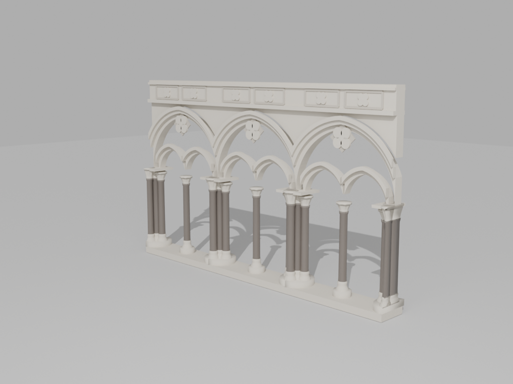 | 13,592 | Sydenham 1854 only. One cloister bay of the English Mediæval Court, pier-centre to pier-centre: twin pointed lights, clustered half-piers, three-order containing arch, spandrel quatrefoil, frieze + cornice. Form drawn from the 1856 guide (the cloister was founded on Guisborough Abbey, per the guide itself); tiles into full clusters. No printed dimensions exist — absolute size is a flagged estimate (±20%); the arcade's paint scheme is unattested, so it ships in the photograph's two tones. Full notes in `sy-gothic-arch-fragment/NOTES.md`. |
| Sydenham Alhambra Court ornament panel (`sy-alhambra-ornament-panel/`) | 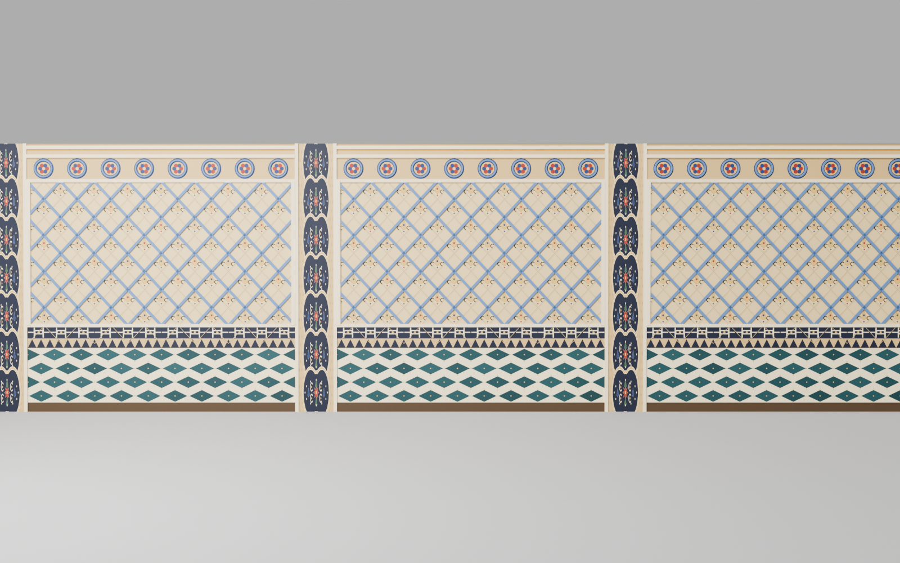 | 3,964 | Sydenham 1854 only. One tileable wall bay: diamond tile dado, dentil + knot bands, sebka field with painted palmettes, roundel frieze, plus the piers' medallion strip. Motifs read from the court's own views (1856 guide p.66 and the coloured entrance print); the medallion fill is a procedural reading and the inscription bands are abstract knot-blocks, not letterforms. This is Owen Jones's Victorian interpretation of Nasrid ornament, not the Alhambra itself. Panel size adopted (±25%). Full notes in `sy-alhambra-ornament-panel/NOTES.md`. |
| [Classical krater vase on pedestal](krater-vase/) | 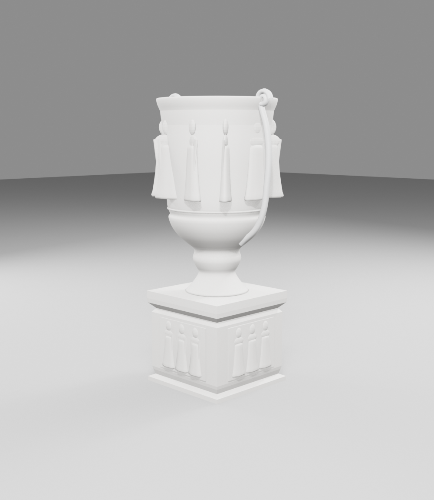 | 42,816 | Sydenham Greek & Roman Court only. The centre krater of the pair in stereograph RP-F-2012-96-327: bell krater with figured relief band on its carved square pedestal. Profile ratios measured from the photograph; absolute scale (1.30 m assembly) inferred against the Aristides cast in the same frame (±~20%). Relief figures are schematic and the volute handles are inferred from the krater type — neither is legibly resolved in the photograph. The dark urn in the MET transept photograph is a different type and is documented, not built. Full notes in `krater-vase/NOTES.md`. |
| [Moving machinery line shafting](machinery-line-shafting/) | 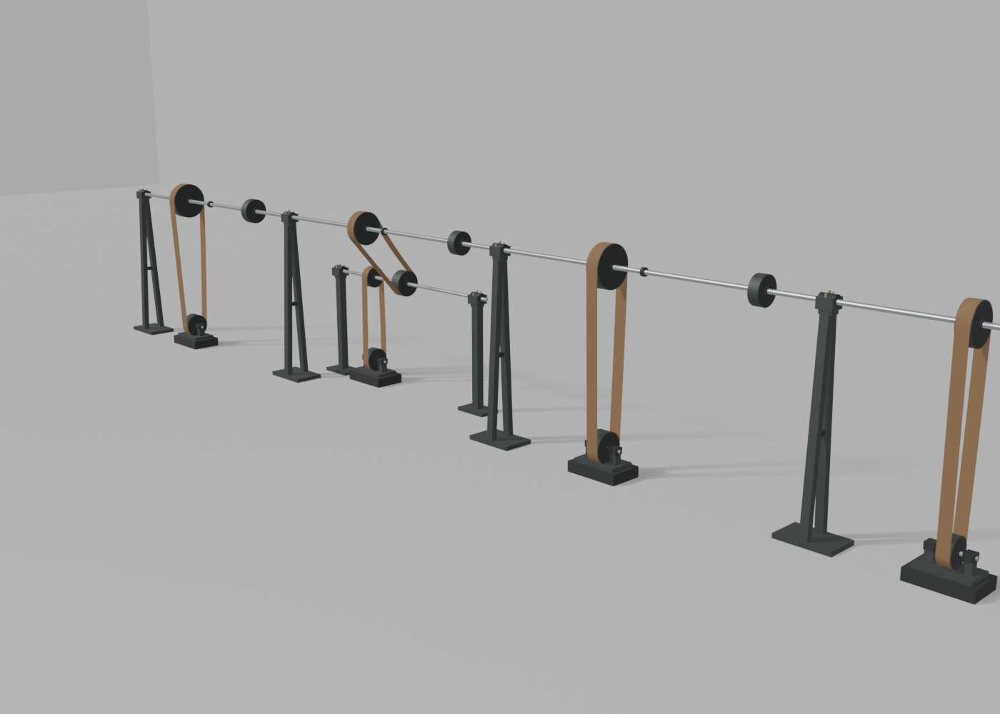 | 12,304 | Hyde Park 1851 machinery court only (CP024 dressing). Set-piece core of candidate #34: a 4-bay overhead line-shaft run — floor standards, plummer blocks, graduated pulleys, countershaft and leather belts dropping to plain floor machine bases (29.26 m on the documented 24 ft module). The Dickinson plate documents the court, not this shaft run: shaft height, sizes and layout are inferred period practice, and no machine in the plate is individually modelled. Full notes in `machinery-line-shafting/NOTES.md`. |
| Hyde Park Osler crystal fountain (`hp-osler-crystal-fountain/`) | 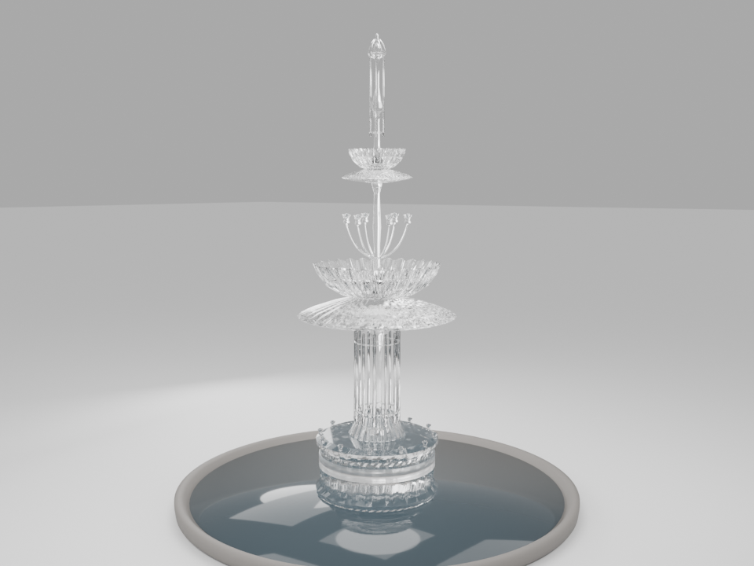 | 30,424 | Hyde Park 1851 only (the Sydenham re-erection was a different installation — do not blend). F. & C. Osler's cut-crystal fountain: 27 ft overall per the exhibitor's own catalogue entry (Class XXIV No. 20), basin 24 ft, form measured tier-by-tier from Ferrier's 1851 plate. Glass is real transmission + fluted geometry, not a solid read. No water plume (a render concern). Full spec trail in `hp-osler-crystal-fountain/NOTES.md`. |
| [Great Exhibition medal, 1851](exhibition-medal-1851/) | 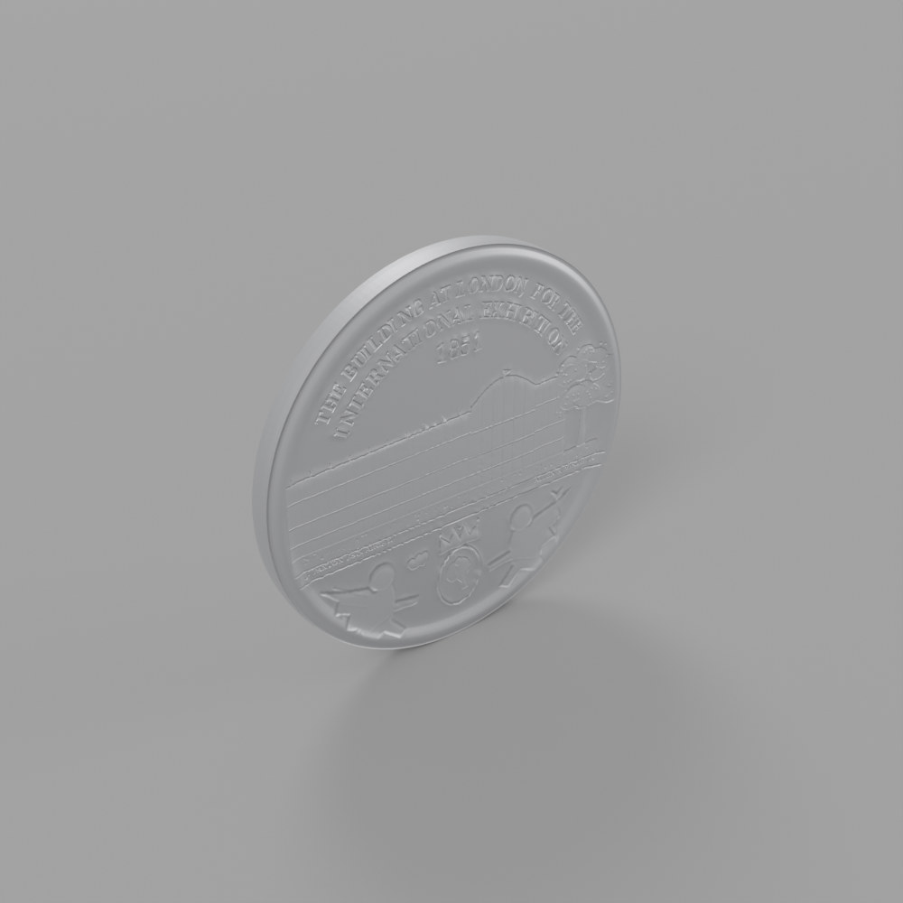 | 39,168 | Hyde Park 1851 only — the Allen & Moore white-metal souvenir medal. Diameter 39 mm is documented (the manifest's own description of the object); both faces are modelled from the collection's photographs of the medal (CC BY-SA 3.0, so this derivative carries share-alike — see NOTES.md). Obverse: the building, the curved legend and the putti-and-medallion exergue scene. Reverse: all sixteen lines of lettering transcribed exactly as struck, including the die's own "855,560 CUBIC FT" slip. Thickness (~3.1 mm), edge form, die alignment and the pictorial relief's fine detail are inferred or schematic, flagged as such in `exhibition-medal-1851/NOTES.md`. |
| Sydenham post-1866 closure set (`sy-post66-closure/`) | 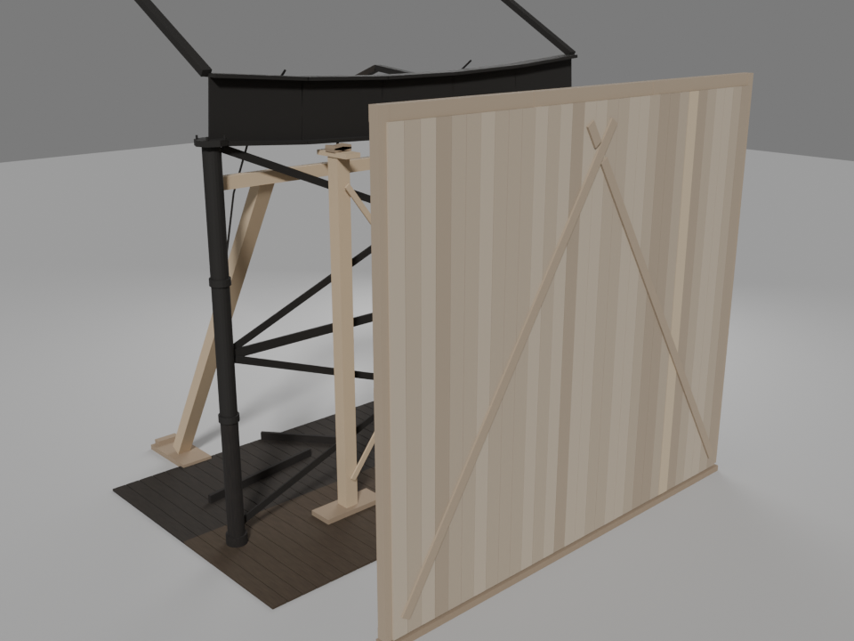 | 3,588 | Sydenham after the 30 Dec 1866 fire (CP048). Three collections: DamagedBay (glassless X-braced end frame, heat-drooped members, on documented palace sizes), Shoring, ClosureScreen. Read the notes before use: the screen and shoring are period-typical RECONSTRUCTIONS — no image of the actual post-fire screen exists in the collection — and the damage degree is chosen dressing, not measured. Full notes in `sy-post66-closure/NOTES.md`. |
| Sydenham 1936 ruin fragment, composed bay (`sy36-ruin-fragment-bay/`) | 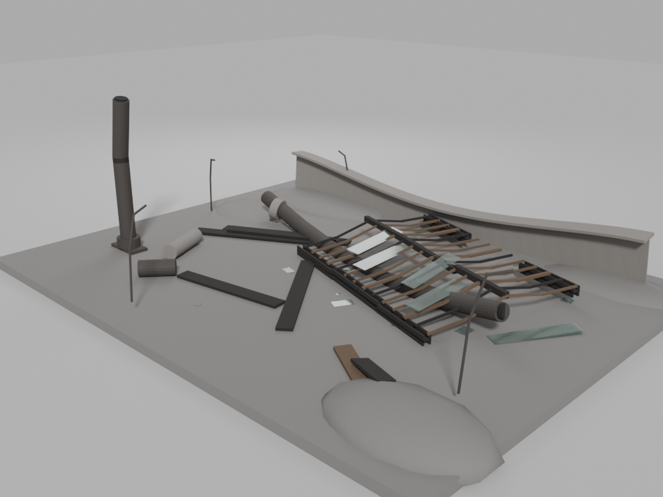 | 3,872 | Sydenham, morning after the 1936 fire. One bay's worth of wreckage on an ash slab: kinked column stump, heat-sagged fallen column, twisted 24 ft girder, collapsed ridge-and-furrow section. Fuller companion to the minimal `sy36-ruin-fragment/`. Failure forms are read from the 1936 aerials (overall) and the 1867 ground-level ruins engravings (detail) — that transfer is flagged as interpretation in the notes. Full notes in `sy36-ruin-fragment-bay/NOTES.md`. |
