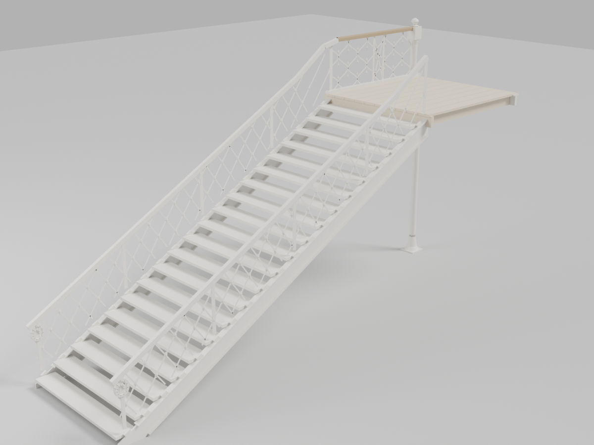
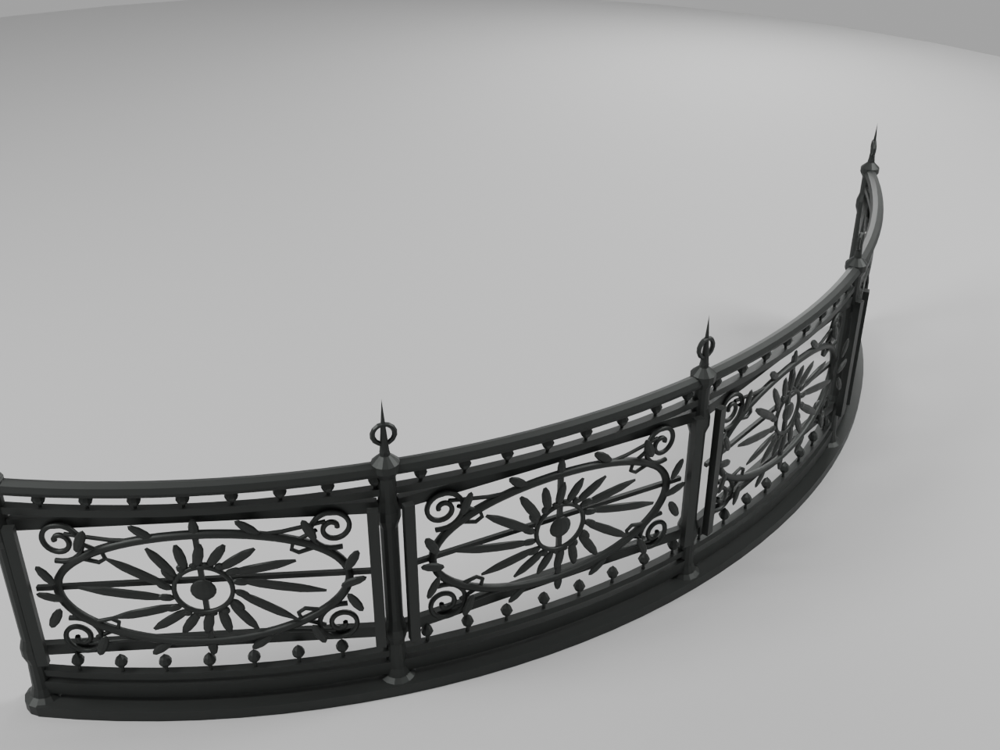
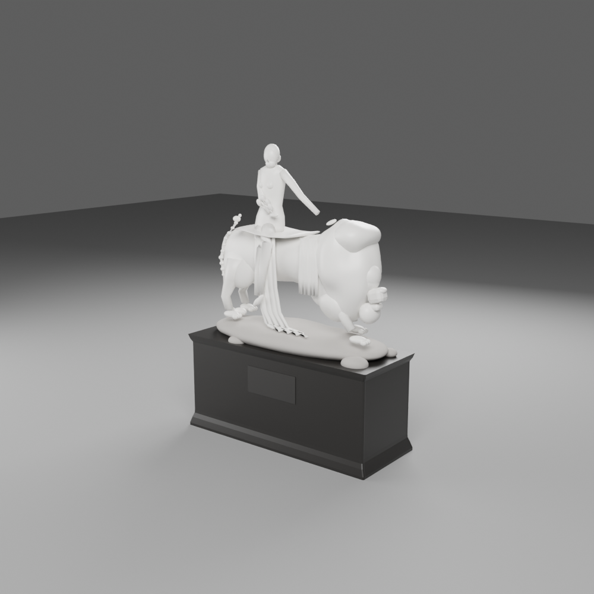
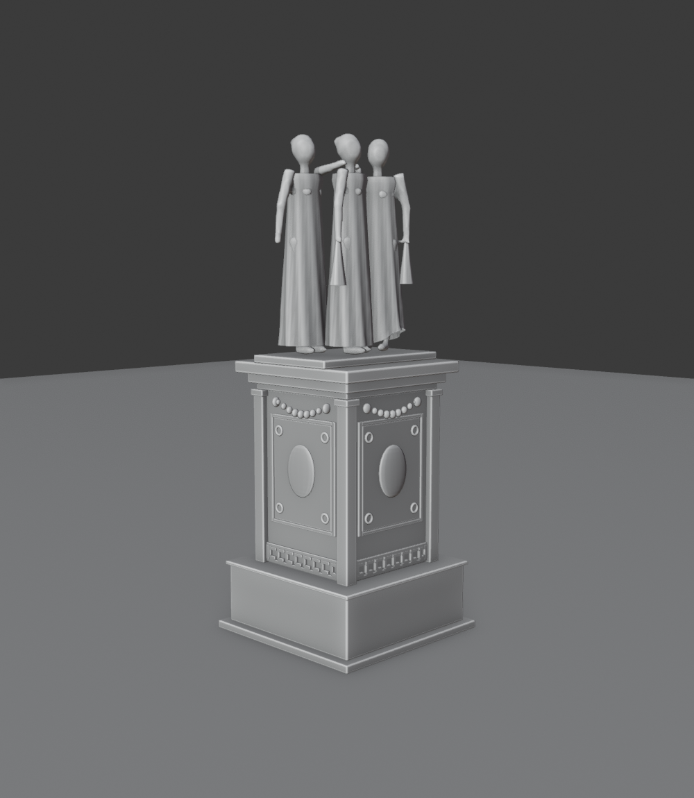

# Models

Built by Muse from the reference images. See `../MUSE-PROMPT.md`.

| Model | Thumbnail | Triangles | Accuracy note |
|---|---|---|---|
| [Egyptian Court colossi](egyptian-court-colossi/) |  | 30,232 | Abu Simbel-type seated pair as at Sydenham, c.1856 (film scene CP038). All proportions measured from the single frontal photograph in the collection; height (20.0 m statues) **inferred** from that photograph's pedestal-door ratio and corroborated by the 1856 guide's statement that the figures equal the Abu Simbel originals in size. Depths, sides and backs are inferred — no side view survives in the collection. Stylised block construction, no invented inscriptions. See `egyptian-court-colossi/NOTES.md`. |
| [Hyde Park tier-1 iron column + girder stub](hyde-park-column-tier1/) |  | 2,560 | Hyde Park 1851 only. Floor to girder bottom 19 ft 2 in and 3 ft girder depth are printed on Downes Plate VIII; outer diameter 10 in is nominal (printed bore 8 in, wall range ⅜–1¼ in); intermediate collar positions, girder stub length (1.5 m) and paint colour are inferred/interpretive. Full table in `hyde-park-column-tier1/NOTES.md`. |
| [Hyde Park glazing and sash panel](hp-glazing-and-sash-panel/) |  | 156 | Hyde Park 1851 only. Sash-bar centres 10½ in (Plate XII) and glass length 49 in (printed p.15); bar section, end-rail width and glass thickness are guessed. Full table in `hp-glazing-and-sash-panel/NOTES.md`. |
| [Hyde Park open-boarded floor section](hp-floor-boards/) |  | 288 | Hyde Park 1851 only. Boards 1½ in thick, ½ in gaps, joists 7 × 2½ in, sleepers 13 × 3¼ in at 8 ft — all printed in the Official Catalogue (1851) Introduction p.62, Paxton's own account; board width (9 in) and joist spacing (2 ft) inferred and labelled. 24 objects: 15 boards, 7 joists, 2 sleepers. Full table in `hp-floor-boards/NOTES.md`. |
| [Great elm, procedural generic](hp-great-elm/) |  | 628 | Hyde Park 1851 only. Generic mature-elm silhouette for instancing in transept scenes — all sizes guessed (18 m height, 5 m clear trunk); no dimensioned elm exists in the references, so never caption it as a particular transept elm or quote its height as measured. Full table in `hp-great-elm/NOTES.md`. |
| [Packing crate + exhibition vitrine](hp-crate-and-display-case/) |  | 360 | Hyde Park 1851 only. Slatted crate (1.0 × 0.8 × 0.8 m) beside a glass vitrine on a plinth (glass 1.2 × 0.6 × 1.0 m, plinth 0.9 m) — all sizes guessed; vitrine form follows the Dickinson plates, no contents or labels invented. Full table in `hp-crate-and-display-case/NOTES.md`. |
| [Sydenham terrace step + balustrade](sy-terrace-step-and-balustrade/) |  | 324 | Sydenham only, no specific terrace level or date asserted. 6 steps, 0.30 m going / 0.15 m rise, 3.0 m wide, balustrade both sides — all sizes guessed; the 1857 map gives position, not step sizes. No fountains implied. Full table in `sy-terrace-step-and-balustrade/NOTES.md`. |
| [1936 ruin fragment](sy36-ruin-fragment/) |  | 204 | Sydenham post-1936-fire state only — never an intact component. Broken column stub, kinked fallen girder, fallen column length. Column diameter and girder depth reused from the column prop; break height, kink, flange width and lengths guessed; generic ruin, not a surveyed remain. Full table in `sy36-ruin-fragment/NOTES.md`. |
| Hyde Park gallery stair + rail (`hp-gallery-stair/`) |  | 6,596 | Hyde Park 1851 only. One flight (21 risers, 1 ft treads) to a 24 × 8 ft landing at 11 ft 5½ in — exactly half the printed gallery height. X-lattice flight balustrade with scroll feet; wavy-bar gallery rail with lozenge bosses and timber handrail (Plate XVII). Tread build-up and deck details inferred and labelled; well-hole edges deliberately unmodelled (no plate draws them). Full table in `hp-gallery-stair/NOTES.md`. |
| [Fountain-basin railing](fountain-basin-railing/) |  | 44,494 | Ornamental cast-iron screen round the Osler Crystal Fountain basin, from the MET transept photograph (CC0) — the only clear view in the collection. 90-degree quadrant, 4 bays at radius 3.5 m: radius **inferred** from the Wellcome engraving's basin-to-fountain proportion against the documented 27 ft fountain height (no measured basin dimension in the references); overall height 1.07 m inferred from the photograph's bay proportions. Floral panel motif is a schematic interpretation (radial flower in an oval wreath, vine scrolls, knob bands, ring-and-spire post finials), not foundry-exact. The 1851 engravings show the Hyde Park basin rim plain, so which installation carried this railing is unresolved. Full table in `fountain-basin-railing/NOTES.md`. |
| [Una and the Lion](una-and-the-lion/) |  | 33,888 | Sydenham sculpture court. John Bell's group as photographed in the MET stereograph (CC0): Una sidesaddle on the walking lion, on its rock base and tall ebonised group plinth (1.10 m). Proportions photo-measured from the stereograph's two views; absolute scale anchored on a life-size seated Una (group 2.16 m, overall 3.256 m) and cross-checked against the display-plinth family - see `una-and-the-lion/NOTES.md`. Display-front profile follows the photograph; the far side and back are **inferred** (no view survives), face and hands schematic, mane smoother than Bell's carving. |
| [The Three Graces](the-three-graces/) |  | 40,028 | Sydenham Greek & Roman Court only. **Stylised group at the limit of the evidence** — the only reference is one small photograph in a Delamotte album sheet (CC0). The pedestal (Greek key band, cartouche panel, swag, low base block) follows the enlarged photograph closely; the draped figures' arrangement also follows it (front pair + one behind), but hands, faces, backs and drapery detail are classical convention and inference, not observation. All dimensions **inferred** from the photograph's proportions assuming life-size figures (1.65 m); pedestal 2.15 m, total height 3.86 m. Full observed/convention/inferred account in `the-three-graces/NOTES.md`. |
