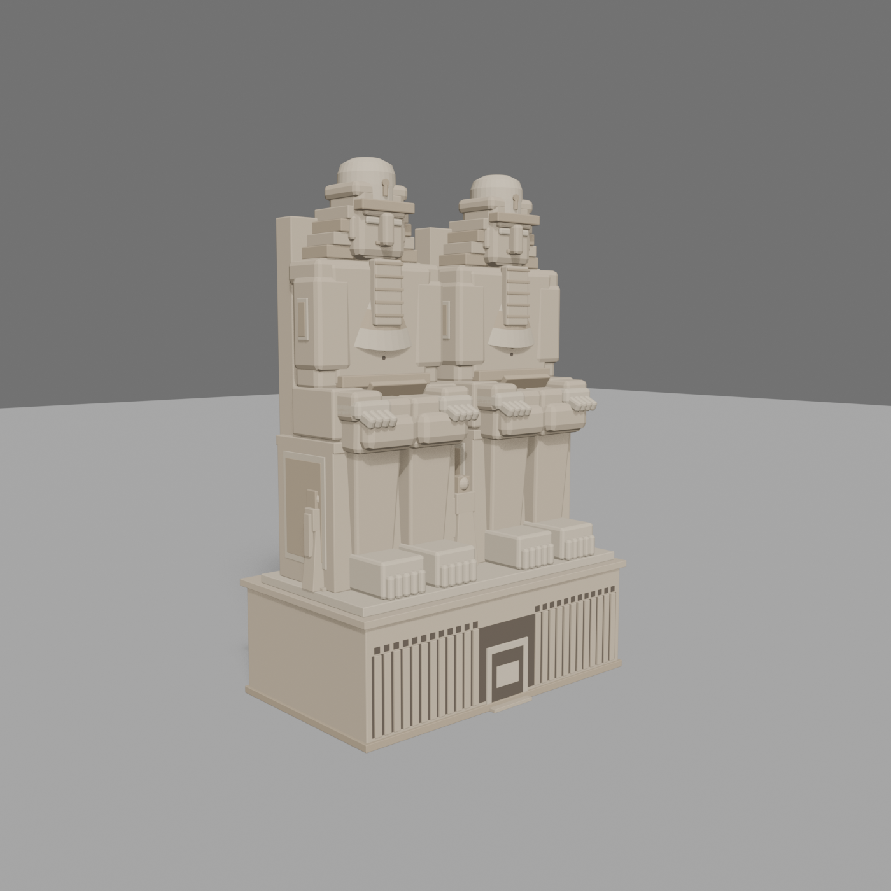
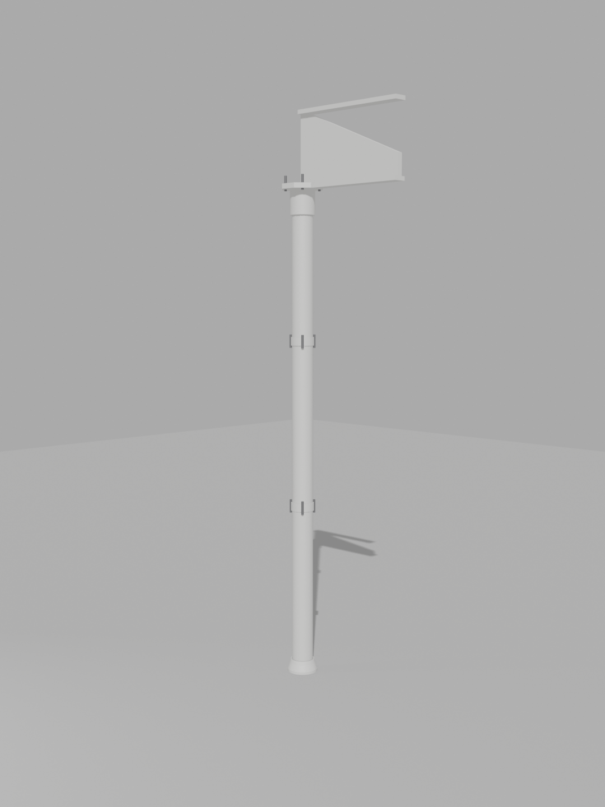
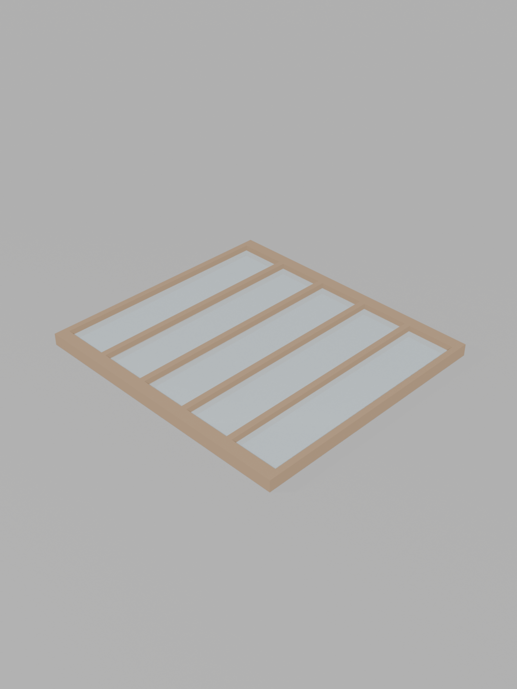
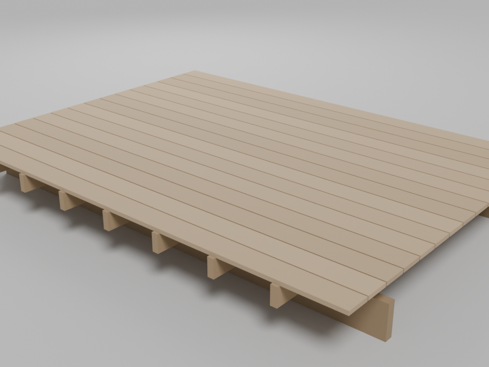
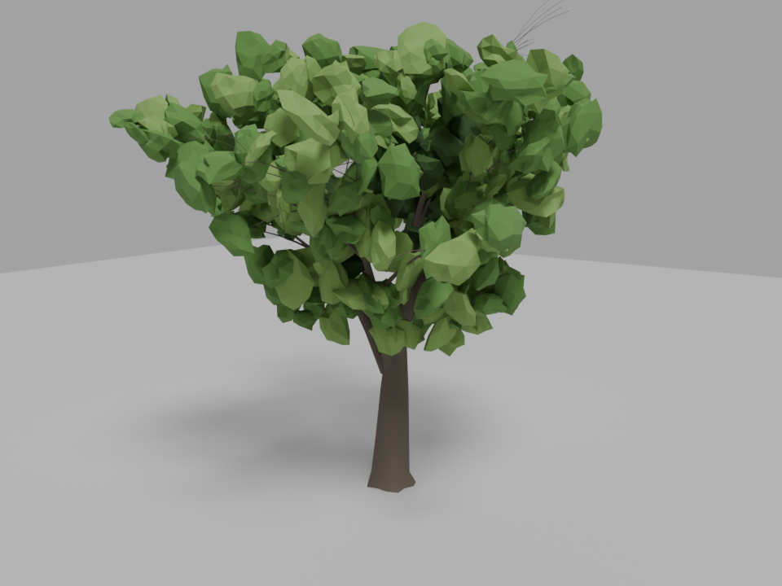
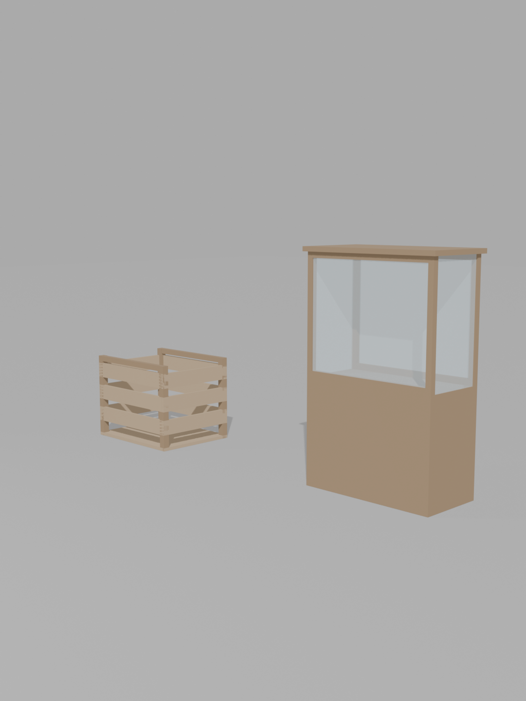
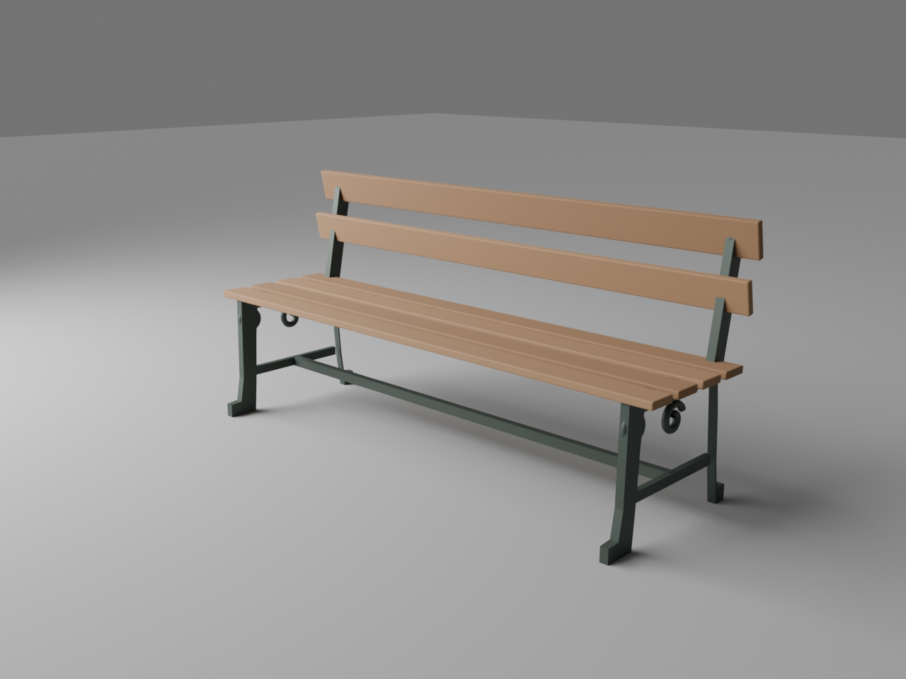

# Models

Built by Muse from the reference images. See `../MUSE-PROMPT.md`.

| Model | Thumbnail | Triangles | Accuracy note |
|---|---|---|---|
| [Egyptian Court colossi](egyptian-court-colossi/) |  | 30,232 | Abu Simbel-type seated pair as at Sydenham, c.1856 (film scene CP038). All proportions measured from the single frontal photograph in the collection; height (20.0 m statues) **inferred** from that photograph's pedestal-door ratio and corroborated by the 1856 guide's statement that the figures equal the Abu Simbel originals in size. Depths, sides and backs are inferred — no side view survives in the collection. Stylised block construction, no invented inscriptions. See `egyptian-court-colossi/NOTES.md`. |
| [Hyde Park tier-1 iron column + girder stub](hyde-park-column-tier1/) |  | 2,560 | Hyde Park 1851 only. Floor to girder bottom 19 ft 2 in and 3 ft girder depth are printed on Downes Plate VIII; outer diameter 10 in is nominal (printed bore 8 in, wall range ⅜–1¼ in); intermediate collar positions, girder stub length (1.5 m) and paint colour are inferred/interpretive. Full table in `hyde-park-column-tier1/NOTES.md`. |
| [Hyde Park glazing and sash panel](hp-glazing-and-sash-panel/) |  | 156 | Hyde Park 1851 only. Sash-bar centres 10½ in (Plate XII) and glass length 49 in (printed p.15); bar section, end-rail width and glass thickness are guessed. Full table in `hp-glazing-and-sash-panel/NOTES.md`. |
| [Hyde Park open-boarded floor section](hp-floor-boards/) |  | 288 | Hyde Park 1851 only. Boards 1½ in thick, ½ in gaps, joists 7 × 2½ in, sleepers 13 × 3¼ in at 8 ft — all printed in the Official Catalogue (1851) Introduction p.62, Paxton's own account; board width (9 in) and joist spacing (2 ft) inferred and labelled. 24 objects: 15 boards, 7 joists, 2 sleepers. Full table in `hp-floor-boards/NOTES.md`. |
| [Great elm, procedural generic](hp-great-elm/) |  | 628 | Hyde Park 1851 only. Generic mature-elm silhouette for instancing in transept scenes — all sizes guessed (18 m height, 5 m clear trunk); no dimensioned elm exists in the references, so never caption it as a particular transept elm or quote its height as measured. Full table in `hp-great-elm/NOTES.md`. |
| [Packing crate + exhibition vitrine](hp-crate-and-display-case/) |  | 360 | Hyde Park 1851 only. Slatted crate (1.0 × 0.8 × 0.8 m) beside a glass vitrine on a plinth (glass 1.2 × 0.6 × 1.0 m, plinth 0.9 m) — all sizes guessed; vitrine form follows the Dickinson plates, no contents or labels invented. Full table in `hp-crate-and-display-case/NOTES.md`. |
| [Park bench](park-bench/) |  | 5,132 | Sydenham gardens. Silhouette-only evidence: one CC0 photograph of the fountain gardens shows benches along the walks - a backed bench with two back rails and pale seat surfaces on dark supports. Period cast-iron-ended bench built as an honest approximation; the scrolled end profile and all dimensions (1.90 m slats) are period-typical **inference**, not measured from the photograph. See `park-bench/NOTES.md`. |
