# Models

Built by Muse from the reference images. See `../MUSE-PROMPT.md`.

| Model | Thumbnail | Triangles | Accuracy note |
|---|---|---|---|
| [Egyptian Court colossi](egyptian-court-colossi/) |  | 30,232 | Abu Simbel-type seated pair as at Sydenham, c.1856 (film scene CP038). All proportions measured from the single frontal photograph in the collection; height (20.0 m statues) **inferred** from that photograph's pedestal-door ratio and corroborated by the 1856 guide's statement that the figures equal the Abu Simbel originals in size. Depths, sides and backs are inferred — no side view survives in the collection. Stylised block construction, no invented inscriptions. See `egyptian-court-colossi/NOTES.md`. |
| [Hyde Park tier-1 iron column + girder stub](hyde-park-column-tier1/) |  | 2,560 | Hyde Park 1851 only. Floor to girder bottom 19 ft 2 in and 3 ft girder depth are printed on Downes Plate VIII; outer diameter 10 in is nominal (printed bore 8 in, wall range ⅜–1¼ in); intermediate collar positions, girder stub length (1.5 m) and paint colour are inferred/interpretive. Full table in `hyde-park-column-tier1/NOTES.md`. |
| [Hyde Park glazing and sash panel](hp-glazing-and-sash-panel/) |  | 156 | Hyde Park 1851 only. Sash-bar centres 10½ in (Plate XII) and glass length 49 in (printed p.15); bar section, end-rail width and glass thickness are guessed. Full table in `hp-glazing-and-sash-panel/NOTES.md`. |
| [Hyde Park open-boarded floor section](hp-floor-boards/) |  | 288 | Hyde Park 1851 only. Boards 1½ in thick, ½ in gaps, joists 7 × 2½ in, sleepers 13 × 3¼ in at 8 ft — all printed in the Official Catalogue (1851) Introduction p.62, Paxton's own account; board width (9 in) and joist spacing (2 ft) inferred and labelled. 24 objects: 15 boards, 7 joists, 2 sleepers. Full table in `hp-floor-boards/NOTES.md`. |
| [Great elm, procedural generic](hp-great-elm/) |  | 628 | Hyde Park 1851 only. Generic mature-elm silhouette for instancing in transept scenes — all sizes guessed (18 m height, 5 m clear trunk); no dimensioned elm exists in the references, so never caption it as a particular transept elm or quote its height as measured. Full table in `hp-great-elm/NOTES.md`. |
| [Packing crate + exhibition vitrine](hp-crate-and-display-case/) |  | 360 | Hyde Park 1851 only. Slatted crate (1.0 × 0.8 × 0.8 m) beside a glass vitrine on a plinth (glass 1.2 × 0.6 × 1.0 m, plinth 0.9 m) — all sizes guessed; vitrine form follows the Dickinson plates, no contents or labels invented. Full table in `hp-crate-and-display-case/NOTES.md`. |
| [Sydenham terrace step + balustrade](sy-terrace-step-and-balustrade/) |  | 324 | Sydenham only, no specific terrace level or date asserted. 6 steps, 0.30 m going / 0.15 m rise, 3.0 m wide, balustrade both sides — all sizes guessed; the 1857 map gives position, not step sizes. No fountains implied. Full table in `sy-terrace-step-and-balustrade/NOTES.md`. |
| [1936 ruin fragment](sy36-ruin-fragment/) |  | 204 | Sydenham post-1936-fire state only — never an intact component. Broken column stub, kinked fallen girder, fallen column length. Column diameter and girder depth reused from the column prop; break height, kink, flange width and lengths guessed; generic ruin, not a surveyed remain. Full table in `sy36-ruin-fragment/NOTES.md`. |
| [Present-day plateau marker](park-now-plateau-marker/) |  | 120 | Present-day Sydenham park only — an overlay aid, not a building. Flat outline + 6 marker posts, 1,608 × 384 ft from the 1856 guide table. Registration explicitly approximate until a georeferenced plan + modern survey align it; never a Hyde Park grid. Full table in `park-now-plateau-marker/NOTES.md`. |
| [Sydenham water-tower massing study](sy-tower-study/) |  | 48 | Massing study only — a scale reference for the shell builder, not a reconstruction. Two plain 20 m square × 70 m masses, 80 m apart, flat caps; every size guessed, no tower form, height or demolition narrative asserted. Full table in `sy-tower-study/NOTES.md`. |
| [Chatsworth glasshouse rib bay](chatsworth-glasshouse-rib-bay/) |  | 804 | Illustrative glasshouse bay only — not a surveyed Chatsworth room, not Palace geometry. Three curved ribs, 5 purlins, glass panes, two low side walls; all sizes guessed, Palace rib figures deliberately not reused. Full table in `chatsworth-glasshouse-rib-bay/NOTES.md`. |
| [Alhambra Court arch panel](sy-alhambra-ornament-panel/) |  | 696 | Simplified arch panel from a single in-repo Owen Jones entrance view — not surveyed decoration. Pointed arch, slender columns, stepped muqarnas stylisation, diamond frieze; arch profile, muqarnas and colours are approximations. Full table in `sy-alhambra-ornament-panel/NOTES.md`. |
| Sydenham subway vault bay (`sy-subway-vault-bay/`) |  | 20,112 | Sydenham, 1865 High Level subway ONLY (CP046/CP065/CP071 states). One tileable bay: octagonal cream-brick column, stone capital, fan vault in red-and-cream brick with the listed diamond pattern. The subway survives: dimensions were derived three converging ways from the restoration photographs (round 2, S87) and are photo-estimates (±10%), not a survey. Full notes in `sy-subway-vault-bay/NOTES.md`. |
| [Cast-iron standards A–D](cast-iron-standards/) |  | 25,756 | Hyde Park 1851 only. The four standards of Downes Plate 20a in a row: A, a pinned pair of waisted straps with the curved foot bracket M; B, a riveted box of four printed 2¼ in angle irons; C, the open angle frame with batten bands and timber block K; D, the one-piece cruciform casting with printed 6 in waist. All sizing from the plate's own printed dimensions (common scale ≈ 22.5 px/in, ±4%); C's unseen front width is assumed from B, and A's strap rib and bracket joint are interpreted — see `cast-iron-standards/NOTES.md`. |
| Sydenham classical cast base, two variants (`sy-classical-cast-base/`) |  | 136 | Sydenham 1854 only. The courts' standard dark pedestal: figure height 0.91 m and bust height 1.30 m, plain square die on a foot-step + cove moulding, flat bedding top for a separately-sourced cast. Ratios measured from an eye-level stereo photograph against life-size casts; absolute scale ±0.06–0.08 m. Painted catalogue labels existed but are omitted (no fabricated text). Full notes in `sy-classical-cast-base/NOTES.md`. |
| [Sydenham garden fountain basin](garden-fountain-basin/) |  | 12,632 | Sydenham lower gardens only — the great lower basin in its playing state (storyboard CP042). Lobed plan-form read from the 1886 elevated photograph and the Delamotte view; every absolute dimension **inferred** from the photographs (±~20%) — no measured basin dimension exists in the references. Rim profile simplified (distant in both photos); jets are static display forms; rim urns and statuary are separate candidates, not included. Full table in `garden-fountain-basin/NOTES.md`. |
| Sydenham great fountain basin (`sy-fountain-basin/`) |  | 19,768 | Sydenham, c.1856–57 onward ONLY (fountains first played 18 Jun 1856 — never in the Jun 1854 opening view). One of the MM pair of Great Fountain basins: scalloped medallion + arms, stone rim, hideable still-water disc, low centre plinth. No jets, no sculpture (rim urns/statues documented as omitted). Size is a plan-ratio estimate (±20%) — the two period plans conflict and the notes say so. Full notes in `sy-fountain-basin/NOTES.md`. |
| Sydenham Medieval Court Gothic arch bay (`sy-gothic-arch-fragment/`) |  | 13,592 | Sydenham 1854 only. One cloister bay of the English Mediæval Court, pier-centre to pier-centre: twin pointed lights, clustered half-piers, three-order containing arch, spandrel quatrefoil, frieze + cornice. Form drawn from the 1856 guide (the cloister was founded on Guisborough Abbey, per the guide itself); tiles into full clusters. No printed dimensions exist — absolute size is a flagged estimate (±20%); the arcade's paint scheme is unattested, so it ships in the photograph's two tones. Full notes in `sy-gothic-arch-fragment/NOTES.md`. |
| Sydenham Alhambra Court ornament panel (`sy-alhambra-ornament-panel/`) |  | 3,964 | Sydenham 1854 only. One tileable wall bay: diamond tile dado, dentil + knot bands, sebka field with painted palmettes, roundel frieze, plus the piers' medallion strip. Motifs read from the court's own views (1856 guide p.66 and the coloured entrance print); the medallion fill is a procedural reading and the inscription bands are abstract knot-blocks, not letterforms. This is Owen Jones's Victorian interpretation of Nasrid ornament, not the Alhambra itself. Panel size adopted (±25%). Full notes in `sy-alhambra-ornament-panel/NOTES.md`. |
| [Classical krater vase on pedestal](krater-vase/) |  | 42,816 | Sydenham Greek & Roman Court only. The centre krater of the pair in stereograph RP-F-2012-96-327: bell krater with figured relief band on its carved square pedestal. Profile ratios measured from the photograph; absolute scale (1.30 m assembly) inferred against the Aristides cast in the same frame (±~20%). Relief figures are schematic and the volute handles are inferred from the krater type — neither is legibly resolved in the photograph. The dark urn in the MET transept photograph is a different type and is documented, not built. Full notes in `krater-vase/NOTES.md`. |
| [Moving machinery line shafting](machinery-line-shafting/) |  | 12,304 | Hyde Park 1851 machinery court only (CP024 dressing). Set-piece core of candidate #34: a 4-bay overhead line-shaft run — floor standards, plummer blocks, graduated pulleys, countershaft and leather belts dropping to plain floor machine bases (29.26 m on the documented 24 ft module). The Dickinson plate documents the court, not this shaft run: shaft height, sizes and layout are inferred period practice, and no machine in the plate is individually modelled. Full notes in `machinery-line-shafting/NOTES.md`. |
| Hyde Park Osler crystal fountain (`hp-osler-crystal-fountain/`) |  | 30,424 | Hyde Park 1851 only (the Sydenham re-erection was a different installation — do not blend). F. & C. Osler's cut-crystal fountain: 27 ft overall per the exhibitor's own catalogue entry (Class XXIV No. 20), basin 24 ft, form measured tier-by-tier from Ferrier's 1851 plate. Glass is real transmission + fluted geometry, not a solid read. No water plume (a render concern). Full spec trail in `hp-osler-crystal-fountain/NOTES.md`. |
| [Great Exhibition medal, 1851](exhibition-medal-1851/) |  | 39,168 | Hyde Park 1851 only — the Allen & Moore white-metal souvenir medal. Diameter 39 mm is documented (the manifest's own description of the object); both faces are modelled from the collection's photographs of the medal (CC BY-SA 3.0, so this derivative carries share-alike — see NOTES.md). Obverse: the building, the curved legend and the putti-and-medallion exergue scene. Reverse: all sixteen lines of lettering transcribed exactly as struck, including the die's own "855,560 CUBIC FT" slip. Thickness (~3.1 mm), edge form, die alignment and the pictorial relief's fine detail are inferred or schematic, flagged as such in `exhibition-medal-1851/NOTES.md`. |
| Sydenham post-1866 closure set (`sy-post66-closure/`) |  | 3,588 | Sydenham after the 30 Dec 1866 fire (CP048). Three collections: DamagedBay (glassless X-braced end frame, heat-drooped members, on documented palace sizes), Shoring, ClosureScreen. Read the notes before use: the screen and shoring are period-typical RECONSTRUCTIONS — no image of the actual post-fire screen exists in the collection — and the damage degree is chosen dressing, not measured. Full notes in `sy-post66-closure/NOTES.md`. |
| Sydenham 1936 ruin fragment, composed bay (`sy36-ruin-fragment-bay/`) |  | 3,872 | Sydenham, morning after the 1936 fire. One bay's worth of wreckage on an ash slab: kinked column stump, heat-sagged fallen column, twisted 24 ft girder, collapsed ridge-and-furrow section. Fuller companion to the minimal `sy36-ruin-fragment/`. Failure forms are read from the 1936 aerials (overall) and the 1867 ground-level ruins engravings (detail) — that transfer is flagged as interpretation in the notes. Full notes in `sy36-ruin-fragment-bay/NOTES.md`. |
| Sydenham water tower massing (`sy-water-tower-massing/`) | 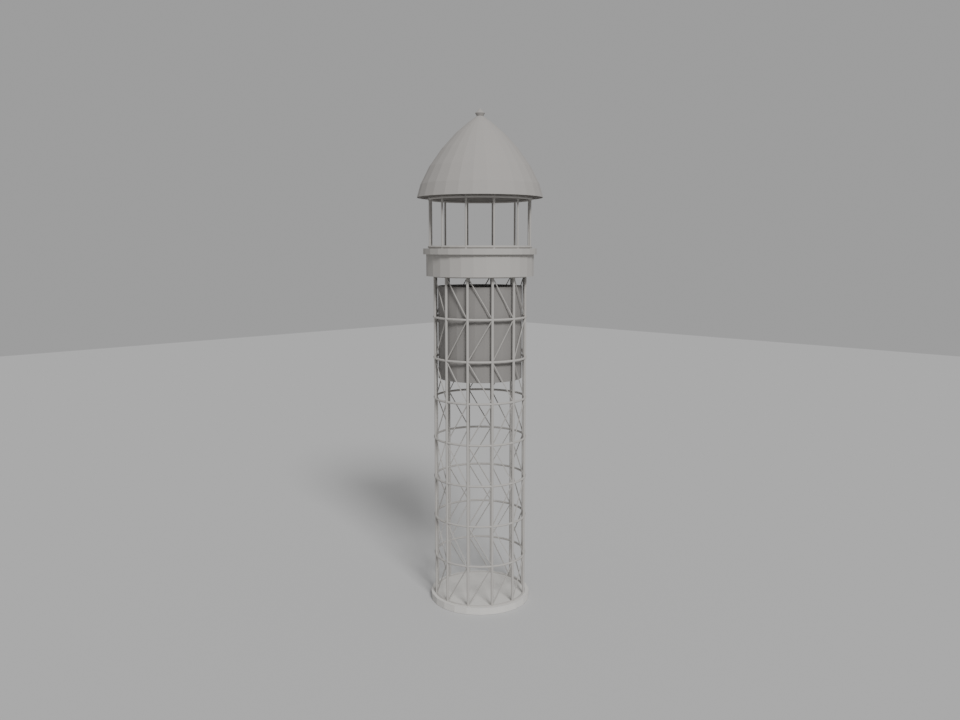 | 8,472 | Sydenham, from Jun 1856 (operational 2 Jun 1856 — absent from the 1854 opening). MASSING ONLY for skyline/backdrop: Brunel's 12-column cylindrical lattice frame, internal tank (inferred, hideable), gallery, arcaded lantern, conical cap. Height 86 m adopted (record spread 280–284 ft; datum unrecorded, ±1 m). Prefer over the formless `sy-tower-study/` placeholder (70 m, no form asserted). Full notes in `sy-water-tower-massing/NOTES.md`. |
| Present-day terrace edge (`park-now-terrace-edge/`) | 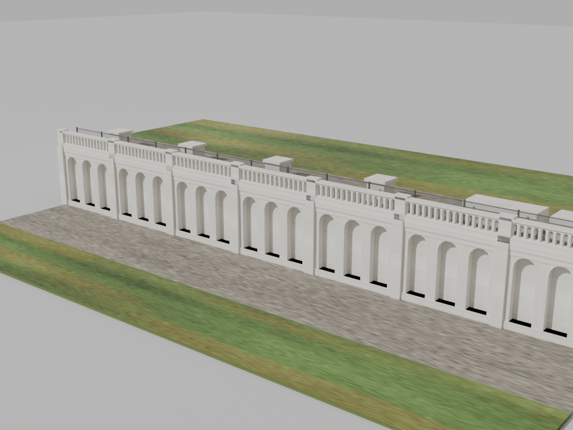 | 6,662 | Crystal Palace Park TODAY (CP072/CP076): a 35 m section of the surviving Upper Terrace edge — niched retaining wall, the arcaded parapet (same dimensions as `sy-terrace-step-and-arcade`), empty statue plinths and sphinx-less bases, gravel, grass, and the modern wire-mesh fence. Complements the flat `park-now-plateau-marker/` footprint overlay. Full notes in `park-now-terrace-edge/NOTES.md`. |
| Sydenham Renaissance Court arch fragment (`sy-renaissance-arch-fragment/`) | 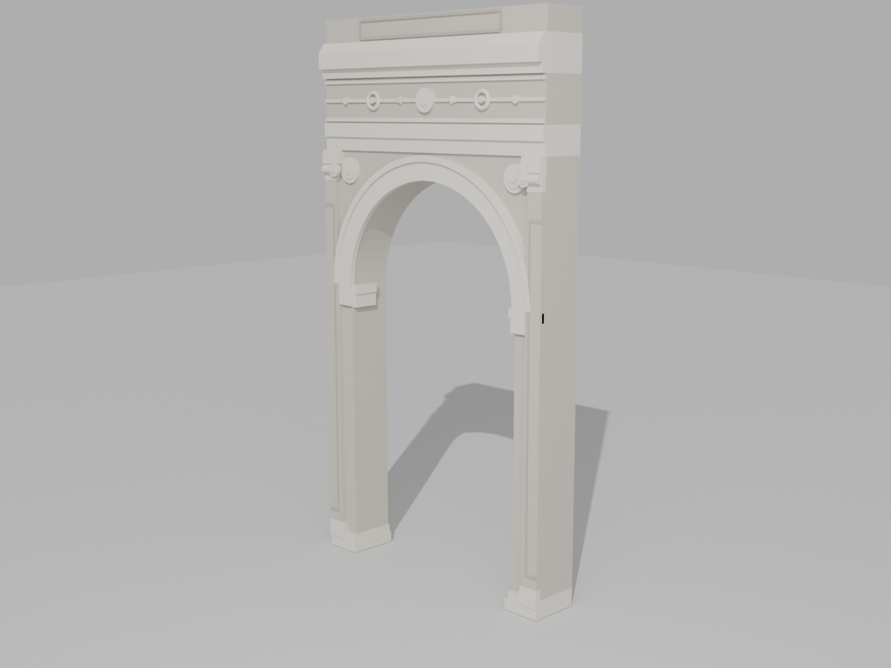 | 3,916 | Sydenham Renaissance (Italian) Court loggia: one repeatable bay — semicircular arch on piers, Ionic pilasters, full entablature, panelled attic. Half-piers at the edges tile into a continuous arcade (tiled proof in the folder). Scale anchored on the Medici tomb cast in the same stereograph (±20%). Sibling to `sy-gothic-arch-fragment/`. Full notes in `sy-renaissance-arch-fragment/NOTES.md`. |
| [Osler Crystal Fountain — playing-state variant](osler-crystal-fountain/) | 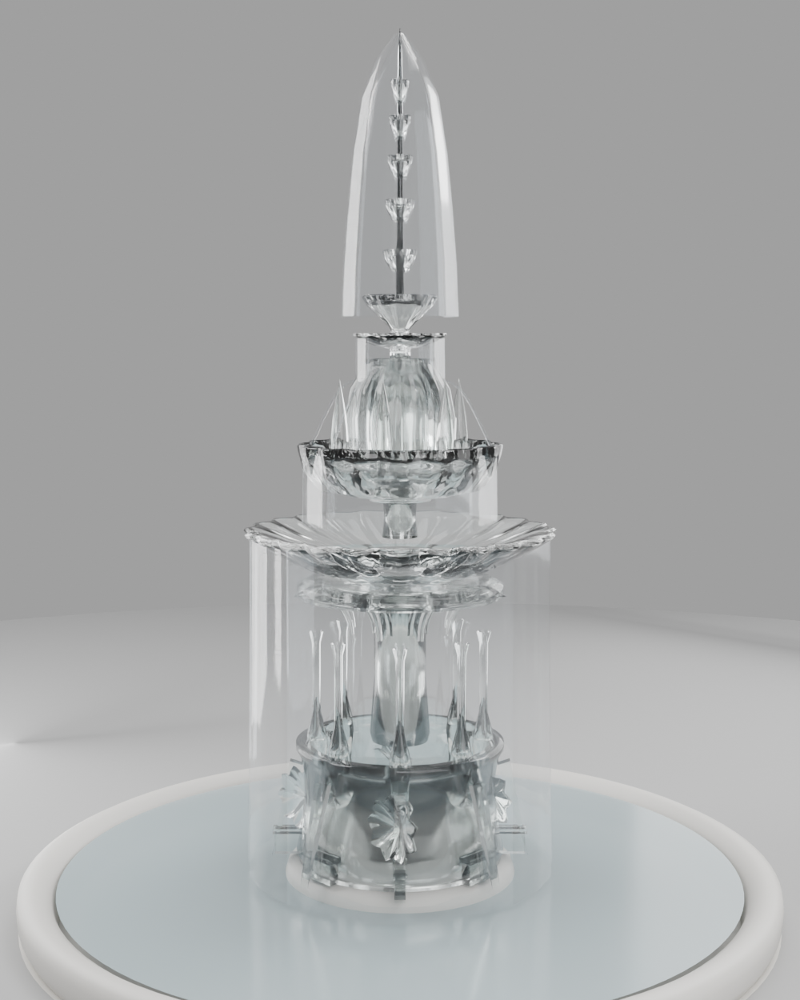 | 33,292 | Hyde Park 1851 centrepiece (CP021/CP022). Variant of the fountain governed by the Wellcome engraving's dish/bowl tier reading, WITH the playing state modelled (static translucent water; hide `Water*` objects for at-rest) and the basin DEFINED at Ø 7.2 m (plate ratios 0.79–0.89 × the documented 27 ft height) — the `fountain-basin-railing` quadrant should be re-radiussed to R 3.6 m to ring it. For the catalogue-sourced domed-tier reading without water, see `hp-osler-crystal-fountain/`. Full notes in `osler-crystal-fountain/NOTES.md`. |
| [Cain and his Children](cain-and-his-children/) | 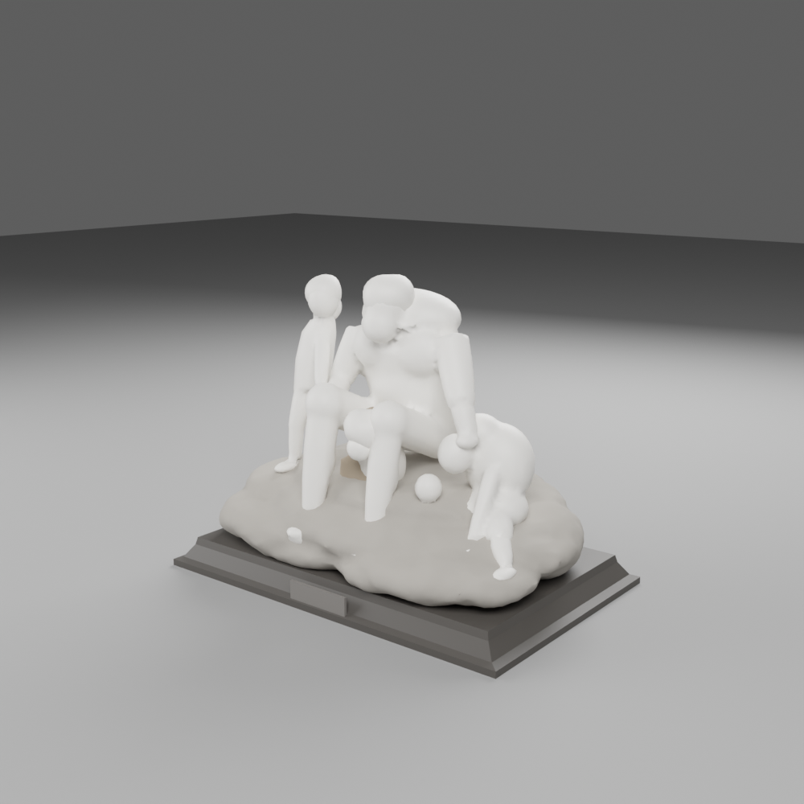 | 48,216 | Sydenham sculpture gallery only. Etex's five-figure group from the single frontal stereograph RP-F-2012-96-336 (CC0): Cain bowed over the rock, the standing boy at his right, three children and the animal pelt clustered in front. Frontal composition tracked across five build rounds; **all depth, sides and back are inference -- no side view exists in the collection**; absolute size photo-estimated (+/-15%). Schematic hands/faces; intertwining shown by overlapping remeshed masses. Full notes in `cain-and-his-children/NOTES.md`. |
| 1850 committee brick scheme, as a model (`committee-brick-model/`) | 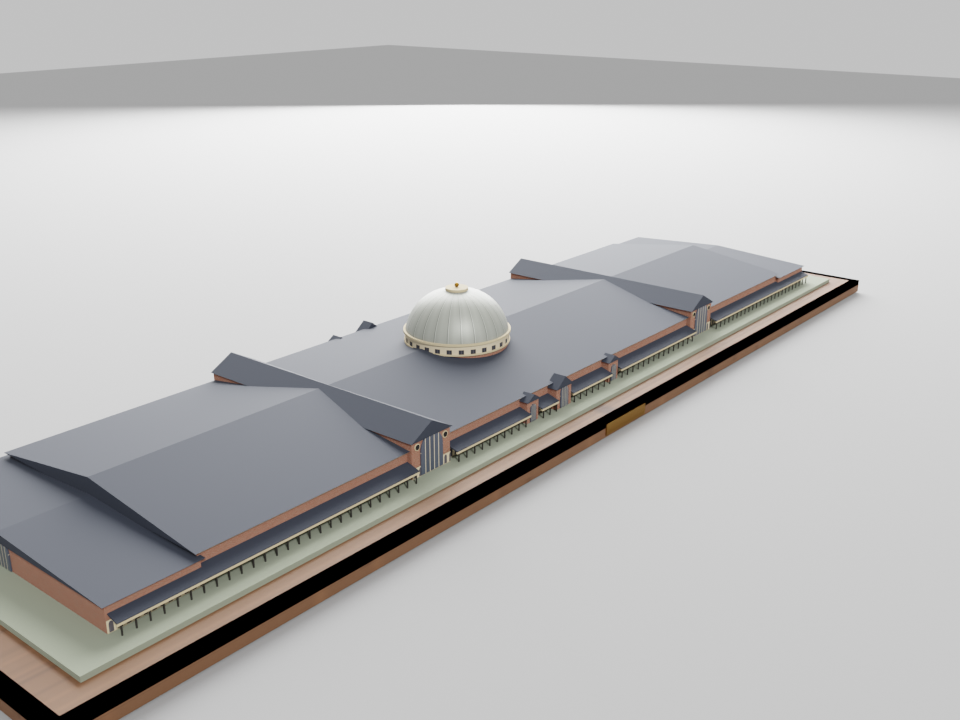 | 8,096 | The Building Committee's rejected brick design (Donaldson) with Brunel's 200 ft iron dome — the famous foil for CP007 — presented at 1:500 on a base board, measured from the ILN 22 Jun 1850 plan (2,000 ft long). No period model of the scheme is recorded; the tabletop presentation is the film's staging device, stated in the notes. Full notes in `committee-brick-model/NOTES.md`. |
| Chatsworth Great Stove rib bay, true scale (`chatsworth-great-stove-rib-bay/`) | 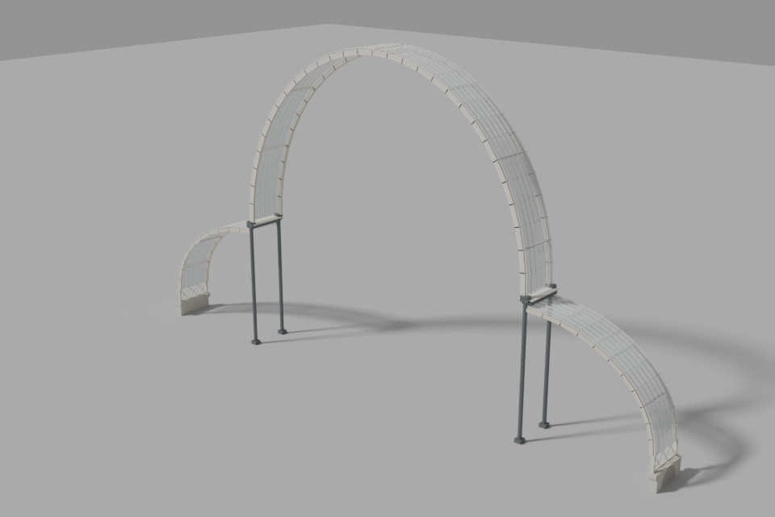 | 10,836 | Chatsworth (1836–40), the Palace's ancestor (CP005) — NOT the Palace. A full-width section slice from printed period figures: 123 ft wide, 70 ft central span, 67 ft crown (period figure; Chatsworth's modern site says 19 m — conflict in the notes), laminated elliptical ribs, quarter-ellipse aisles, ridge-and-furrow glazing. Prefer over the illustrative guessed `chatsworth-glasshouse-rib-bay/`. Full notes in `chatsworth-great-stove-rib-bay/NOTES.md`. |
| Sydenham concert organ front (`sy-concert-organ-front/`) | 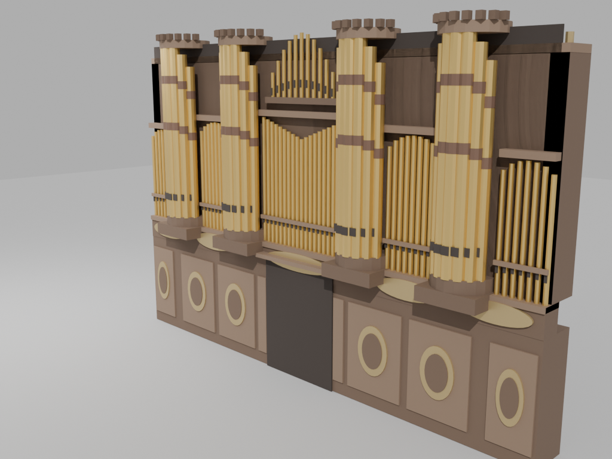 | 9,856 | Sydenham central transept, festival era (CP050/CP055): the Gray & Davison organ's pipe FRONT only (40 ft wide per *The Engineer* 1882; form from the c.1860s stereo and the c.1899 Handel Festival photograph, which show the same front). Four towers, five flats, 110 gilt front pipes, medallion base, console recess left empty (the detached console is a separate object). Interior/depth not modelled. Full notes in `sy-concert-organ-front/NOTES.md`. |
| Hawkins Iguanodon mould + dinner table (`hawkins-mould-and-table/`) | 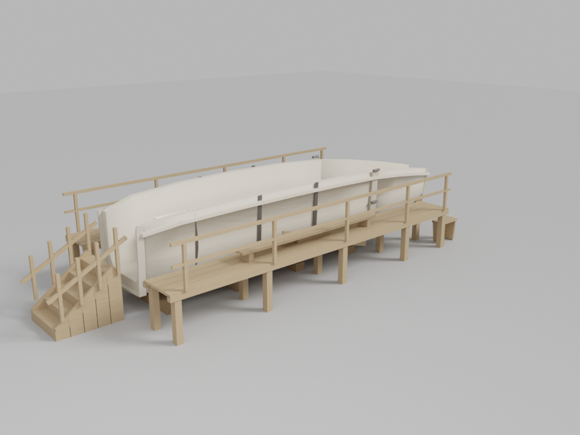 | 2,504 | Sydenham workshop, New Year's Eve 1853 (CP034): the open ventral half-mould of the Iguanodon as a WORKSHOP artefact on its timber cradle — never a finished dinosaur — with staging decks, stair, and the long dinner table inside the cavity (the famous dinner for 21 was held in the mould; Owen sat at the head per the ILN of 7 Jan 1854). Full notes in `hawkins-mould-and-table/NOTES.md`. |
| [Glass-topped display counter](glass-topped-display-counter/) | 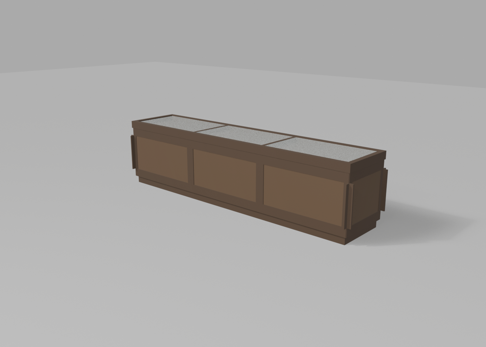 | 492 | Hyde Park 1851 only. One 12 ft unit of the standard nave counter run: panelled timber carcase, flat glazed top in sash framing over a dark cloth bed; units tile into the long runs seen along the nave. Seen only in wide views (Talbot's *View of Eastern Nave*; Dickinson plate XXIV) — every dimension is **inferred**: length set at half the documented 24 ft bay, height (~0.94 m) from figure scale in the plate, panel and sash detail is period-standard, not observed. A type model, not a portrait of a named counter; distinct from the legged table case in `hp-crate-and-display-case/`. Full notes in `glass-topped-display-counter/NOTES.md`. |
| [Cut-glass chandelier](cut-glass-chandelier/) | 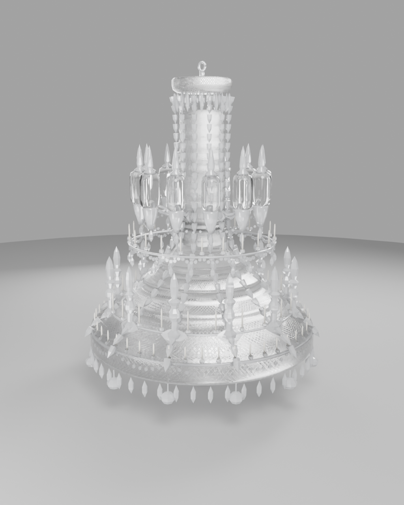 | 47,356 | Hyde Park 1851 only (CP019/CP025 dressing). The tent-form chandelier from the single governing engraving in *The Crystal Palace and its contents* (1851–52; public domain): canopy + diamond-cut shaft, 12 fluted finial vases, candle tiers of 24 + 24 + 48, trumpet cone, lozenge fringe, petal-cup finial. All proportions measured off the plate (W/H 0.759); **absolute size is adopted, not documented** — the 5.5 m height is a grand-exhibition inference and rescales cleanly. Counts are nearest regular-ring readings of the engraver's projections; scroll arms simplified; suspension eye an added, hideable object. Full notes in `cut-glass-chandelier/NOTES.md`. |
| [Terrace statue, surviving headless](terrace-statue-survivor/) | 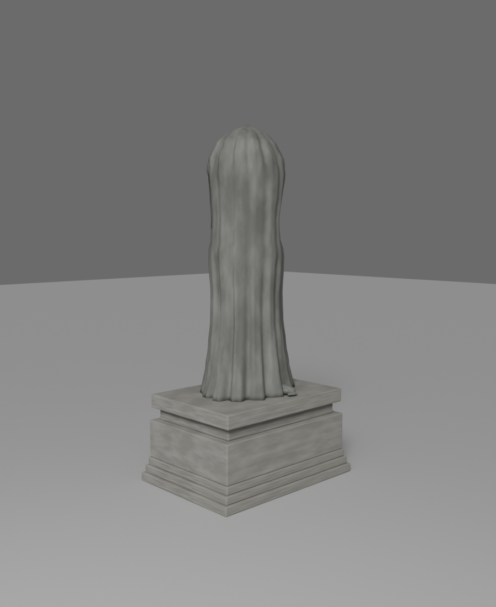 | 14,984 | Present-day Crystal Palace Park ONLY — the statue **as it survives today**, never 1854 dressing. One of the Upper Terrace pilaster statues in its weathered, headless state (CP072/CP076 family): columnar draped figure, diagonal back swag, dark cavity in the left flank, one foot at the hem, on its stepped pedestal. Built from a single rear three-quarter photograph (Geograph 2436241, CC BY-SA 2.0); figure height 3.00 m adopted from the photo's figure:pedestal ratio against the shipped terrace parapet scale (±20%); the whole front is drapery-logic inference, and the head and arms are absent because they are lost in reality, not omitted. Full notes in `terrace-statue-survivor/NOTES.md`. |
| [Gallery lattice railing and newel post](gallery-lattice-railing/) | 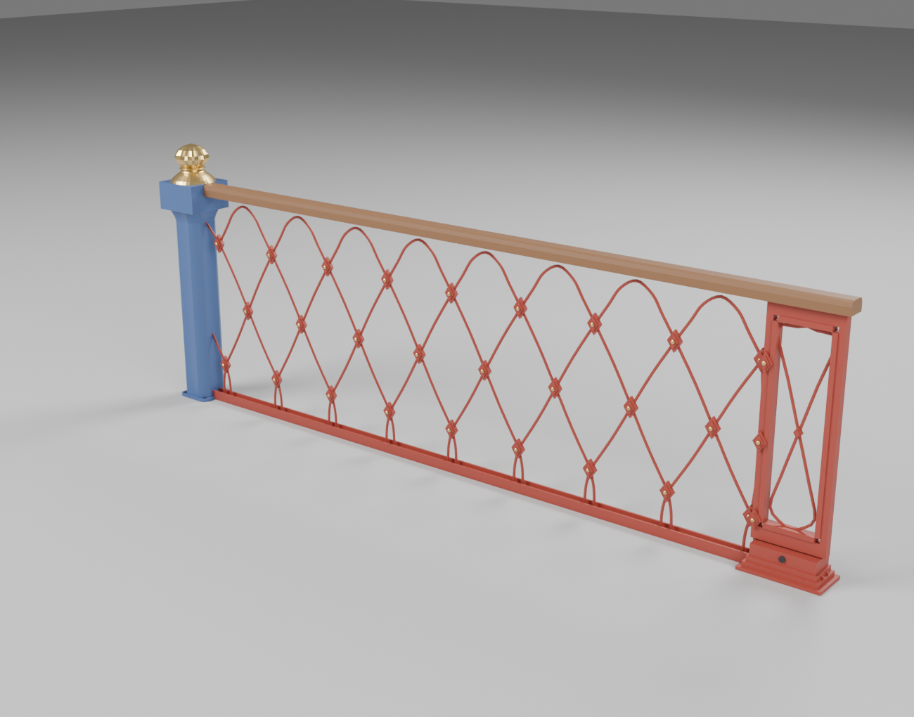 | 25,872 | Hyde Park 1851 only. The repeating gallery-front railing from Downes Plate XVII: wavy-bar diamond lattice with lozenge bosses (boss rows and 12.43 in column pitch measured on Fig. 12, calibrated at 38.6 px/in against the printed rail height), frame standard with its lozenge-centred inner panel, and newel post M (printed 3 ft 1 7/8 in to cap top plus 6 1/4 in bud finial; shaft section from Fig. 8). Colours from the Absolon watercolour: red lattice, blue newel, gilt finial and boss centres. Panel length (8 lattice periods), bar thickness and the floor-level bottom channel are inferred/interpreted; the below-floor edge girder and Fig. 10 stay bracket are not modelled. Full table in `gallery-lattice-railing/NOTES.md`. |
| [Iguanodon](iguanodon/) | 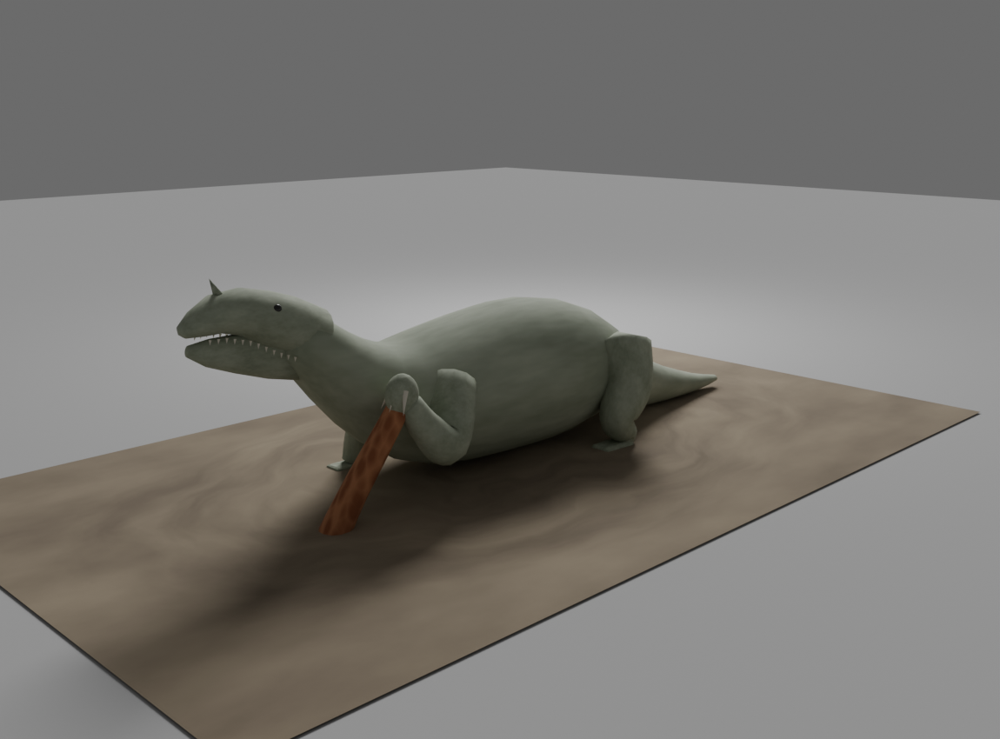 | 9,864 | Sydenham grounds and present-day park (CP043/CP047). Hawkins's 1854 concrete Iguanodon AS IT SURVIVES — the sprawled foreground animal of the collection's single photograph, head raised, near foreleg gripping the reddish conifer trunk, tail dragging; quadrupedal with the thumb spike on its nose, deliberately NOT modern-corrected. Overall length 30 ft adopted from the ILN of 5 Nov 1853 (via `hawkins-mould-and-table/NOTES.md`); pose, tooth fringe and current pale green-grey paint read from the photograph (CC BY-SA 2.0); the far side, back and every other absolute size are inferred, the head is a stylisation, and the scale armour is a .blend-only procedural bump (the .glb carries flat colour). The standing second Iguanodon is not modelled. Full notes in `iguanodon/NOTES.md`. |
| [Glazing wagon](glazing-wagon/) | 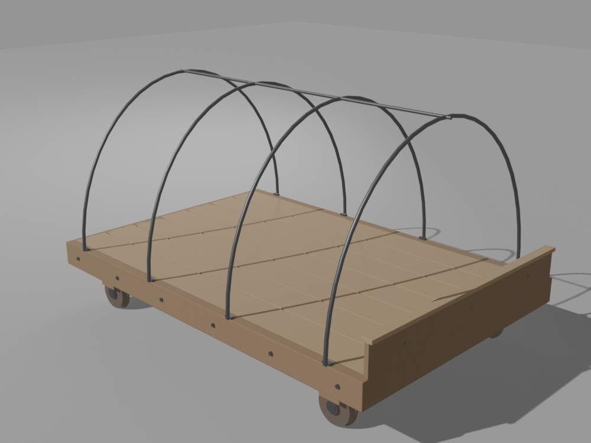 | 5,716 | Hyde Park 1851 construction only (CP010/CP013). Charles Fox's glazing waggon — the glaziers' movable platform that ran in the roof gutters: lengthwise-boarded deck on deep bolted side beams, four thin iron hoop bows tied by a crown bar, raised end upstand at the drawn end, plain flanged wheels. Built from the single PD engraving (three-quarter view; crew omitted — people are not props). **Every dimension is inferred**: deck width 2.44 m adopts the 8 ft ridge-and-furrow slope module (49 in panes, 10½ in sash-bar centres, Pl. XII), deck length and the 1.50 m hoop rise are scaled from the crew figures (~1.7 m men), and the wheels and 1.98 m gauge are conjectural — the engraving hides the running gear behind the roof slope. Full notes in `glazing-wagon/NOTES.md`. |
| [Lattice girder / truss bay](lattice-girder-truss-bay/) | 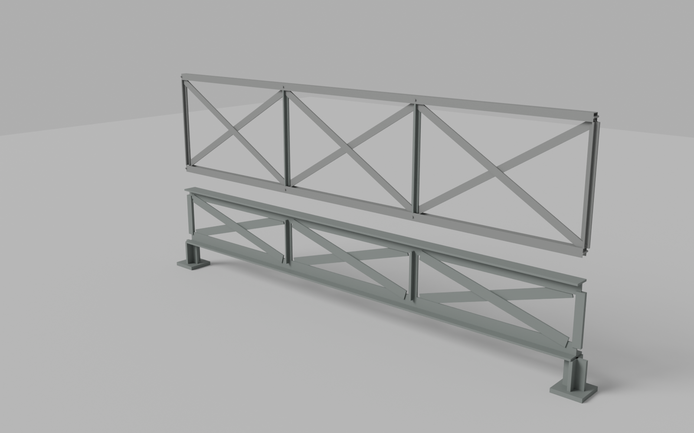 | 856 | Hyde Park 1851 only. One 24 ft structural bay as a comparison stack of two alternative members — NOT an as-built assembly: the cast-iron lattice girder of Downes PL. 10 Fig. 3 (span 24 ft printed; its depth chain prints 3 ft 1¼ in) below, and one 24 ft bay (three 8 ft panels) of the wrought-iron 48 ft roof truss of PL. 11 Fig. I above (top chord two 4 in × 2 in × ¼ in angle irons, bottom chord two 4½ in × ¼ in bars, cruciform standards at 8 ft centres, 1⅛ in joint pins — all printed; truss depth ≈ 5 ft 6 in plate-measured, not printed). Short cruciform column stubs give the bearing condition. Girder flange widths, web sizes and paint are inferred. Full notes in `lattice-girder-truss-bay/NOTES.md`. |
| [Crampton locomotive "Folkestone"](crampton-locomotive-folkestone/) | 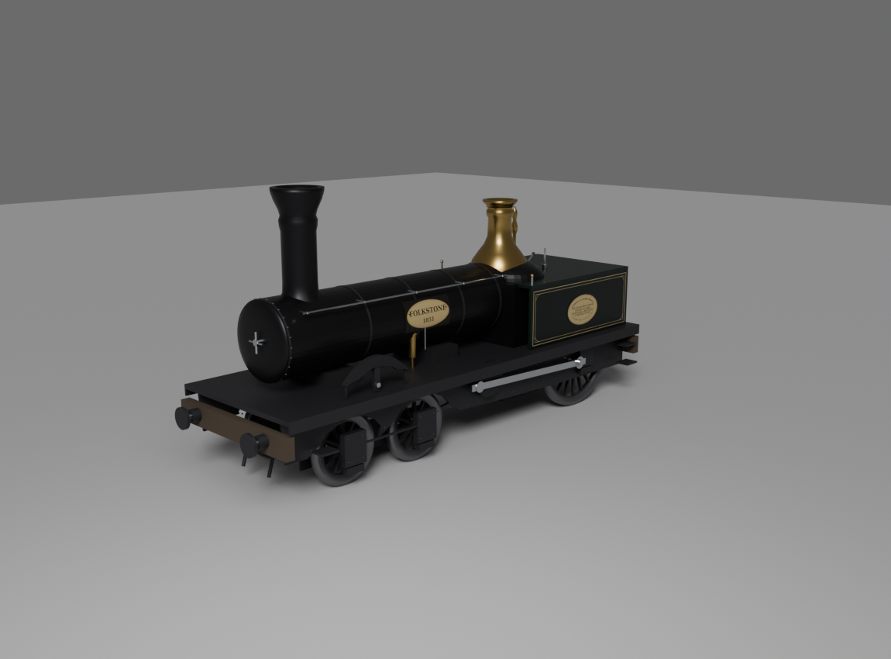 | 22,964 | Hyde Park 1851 only (CP024). SER 4-2-0 Crampton No. 136, Stephenson works no. 787, as exhibited: driving wheels 6 ft and bogie wheels 3 ft 6 in are published for the engine; all other proportions measured on Talbot's calotype at 4.303 mm/px (single side view - far side mirrored, inside motion and all widths inferred). Nameplate keeps the plate's own FOLKSTONE spelling; maker's plate lettering transcribed from the photograph. Full notes in `crampton-locomotive-folkestone/NOTES.md`. |
| [Paxton gutter and main gutter](paxton-gutter/) | 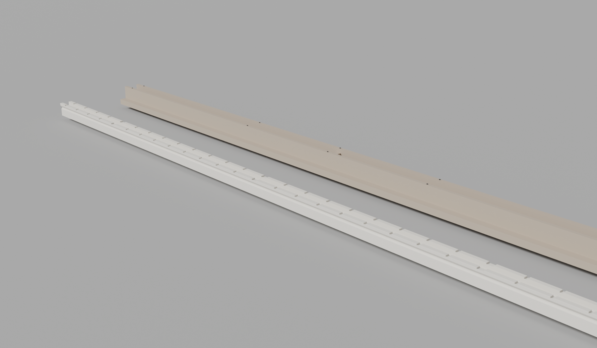 | 1,392 | Hyde Park 1851 only (CP011/CP015). Two standalone 24 ft lengths: Paxton's hollow timber roof gutter from Downes Plate XII Fig. 10 (6 in deep, 5 in base, 3 in channel 3 in deep, side condensation grooves, Fig. 3 notch chain of 27 bar housings per cheek) and the Plate XIII main gutter (open timber channel: 14 in x 2.5 in bottom board, 1.375 in side boards, 5.25 in clear, 8.5 in overall). Both modelled level (main gutter's printed fall 3/8 in in 8 ft noted); end shoes and support struts omitted. Channel depth read 1/2 in deeper than in `hp-roof-furrow-bay/` — discrepancy flagged in `paxton-gutter/NOTES.md`. |
| [South-entrance pedestals](south-entrance-pedestals/) | 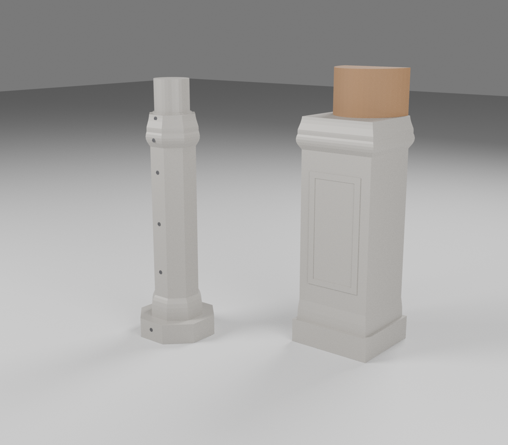 | 1,360 | Hyde Park 1851 only (CP007/CP017). Both pedestals of Downes Plate XXVI at the transept's south entrance: A, the octagonal cast-iron pedestal (a5) of a detached column — total height is the plate's own printed 4 ft 9 in, plan cross-checked two ways (elevation silhouette vs Fig. 27 section, 6% tolerance stated), casing 3/8 in. thick in two pieces united by countersunk screws per Downes' text (screws modelled); and B, the rectangular pedestal (B3) of a semi-elliptical wooden column — plan 23.0 x 21.3 in. and plinth measured from Figs. 29-30 at their own scale, total height adopted equal to A with the undrawn shaft middle reconstructed and flagged. Short stubs show the columns each carried (stub lengths adopted). Full dimension table in `south-entrance-pedestals/NOTES.md`. |
